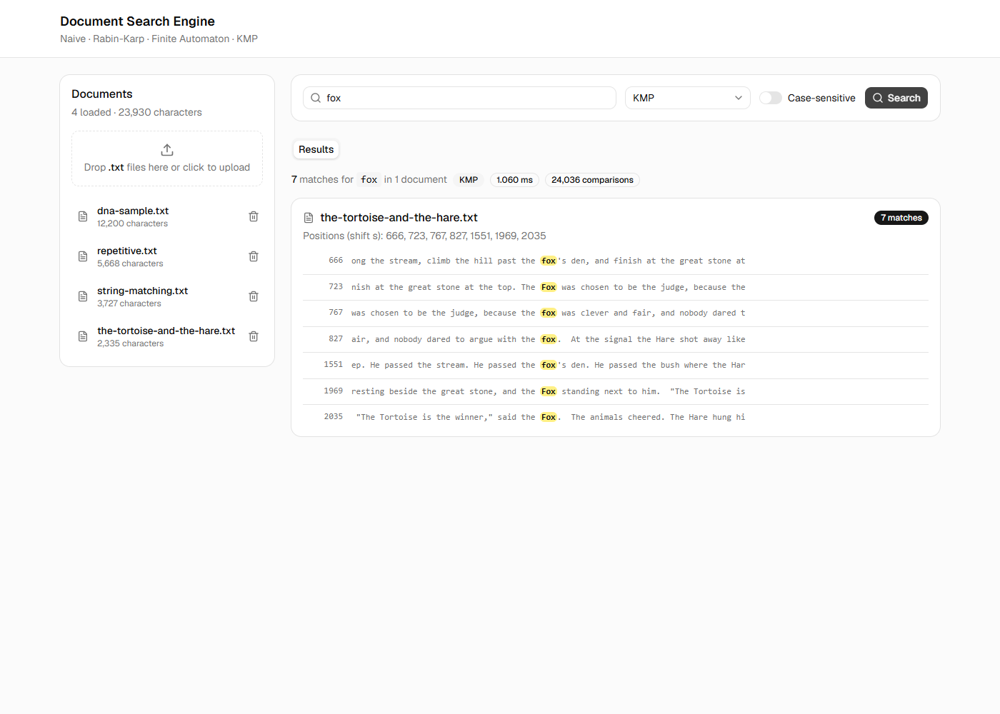

# Document Search Engine — String Matching

A small document search engine built around four classic string matching algorithms. Load `.txt` documents, search them for a pattern, and see how the algorithms compare: running time, number of character comparisons, and the preprocessing table each one builds.



## Features

- **Documents:** sample `.txt` files are included. You can upload your own (drag and drop) or delete them.
- **Search:** find a pattern across all documents with the algorithm you pick. Each result shows the match count, the positions, and snippets with the match highlighted. Case-sensitive search can be switched on or off.
- **Comparison:** runs all four algorithms on the same search and shows time and character comparisons in a table and bar charts.
- **How it works:** for the current pattern, shows each algorithm's complexity, a short explanation, and its preprocessing (KMP π table, Finite Automaton δ table, Rabin-Karp hash values).
- Light and dark mode.

## Algorithms

| Algorithm | Preprocessing | Matching | Idea |
|---|---|---|---|
| Naive | none | O((n−m+1)·m) | Try every shift, compare char by char |
| Rabin-Karp | O(m) | avg O(n+m), worst O((n−m+1)·m) | Compare hashes first (rolling hash, d=256, q=101), check chars only on a hash hit |
| Finite Automaton | O(m³·\|Σ\|) | O(n) | Build a transition table δ(state, char), read each text char exactly once |
| KMP | O(m) | O(n) | Prefix function π tells how far to shift so the text pointer never moves back |

## Tech stack

- **Backend:** Java 21 with only the JDK (`com.sun.net.httpserver`). No Maven, Gradle or external libraries; JSON is written by hand.
- **Frontend:** Vite, React, TypeScript, Tailwind CSS and shadcn/ui. The Vite dev server forwards `/api` requests to the backend.

## Setup

### Requirements

| Tool | Version | Check with |
|---|---|---|
| JDK | 21 or newer (needs `javac`, not just a JRE) | `java -version` and `javac -version` |
| Node.js | 20 or newer (tested on 22) | `node -v` |
| npm | comes with Node.js | `npm -v` |

### 1. Get the code

```bash
git clone <repository-url>
cd "DAA-Document Search Engine"
```

### 2. Start the backend (port 8080)

The run script compiles every `.java` file into `backend/out/` and starts the server, using `backend/documents/` as the document folder.

```bash
# macOS / Linux / Git Bash
cd backend
./run.sh
```

```powershell
# Windows PowerShell
cd backend
.\run.ps1
```

If PowerShell blocks the script, allow it for the current window only:

```powershell
Set-ExecutionPolicy -Scope Process -ExecutionPolicy Bypass
```

To check it is running, open <http://localhost:8080/api/documents>. You should see a JSON list of the sample documents.

### 3. Start the frontend (port 5173)

Open a **second terminal** and keep the backend running in the first one.

```bash
cd frontend
npm install      # first time only
npm run dev
```

Then open <http://localhost:5173> in your browser.

### Production build (optional)

```bash
cd frontend
npm run build    # output goes to frontend/dist/
```

## Usage

1. The left panel lists the loaded documents. Drop your own `.txt` files there to add them; every search covers all of them.
2. Type a pattern (up to 100 characters), choose an algorithm, and press **Enter**.
3. Switch between the **Results**, **Comparison** and **How it works** tabs.

## API

| Method | Path | Params | Returns |
|---|---|---|---|
| GET | `/api/documents` | – | `[{id,name,size}]` |
| POST | `/api/documents?name=x.txt` | raw text body | `{id,name,size}` |
| DELETE | `/api/documents/{id}` | – | 204 |
| GET | `/api/search` | `q, algo, caseSensitive` | `{algorithm,timeMs,comparisons,results:[...]}` |
| GET | `/api/compare` | `q, caseSensitive` | `[{algorithm,timeMs,comparisons,totalMatches}]` |
| GET | `/api/explain` | `q, algo` | `{algorithm,complexity,description,preprocessing}` |

`algo` is one of `NAIVE`, `RABIN_KARP`, `FINITE_AUTOMATON`, `KMP`.

Example:

```bash
curl "http://localhost:8080/api/explain?q=ababaca&algo=KMP"
```

## Project structure

```
backend/
  src/searchengine/
    Main.java                  HTTP server and routes
    algorithms/                Naive, Rabin-Karp, Finite Automaton, KMP
    store/DocumentStore.java   reads/writes backend/documents/*.txt
    service/                   search, compare, explain
    http/                      JSON writer and request handlers
  documents/                   sample .txt files
  run.sh, run.ps1              compile and run scripts
frontend/
  src/
    components/                DocumentPanel, SearchBar, ResultsList, ComparisonView, HowItWorks
    lib/                       API client and types
    App.tsx
docs/                          learning guide (start at docs/README.md)
```

## Troubleshooting

| Problem | Fix |
|---|---|
| `javac: command not found` | Install a JDK 21 (not just a JRE) and add its `bin` folder to `PATH`. |
| `Address already in use` on start | Something else is using port 8080. Stop it, or close the other backend window. |
| UI says the backend is not reachable | Make sure the backend terminal is still running on port 8080, then refresh the page. |
| `./run.sh: Permission denied` | Run `chmod +x run.sh` once, or use `sh run.sh`. |
| Port 5173 is busy | Vite picks the next free port; use the URL it prints. |

## Learn more

The [`docs/`](docs/README.md) folder is a step-by-step guide to the theory behind each algorithm and how this project implements it, with diagrams and worked examples.
