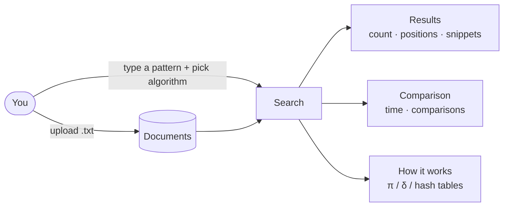
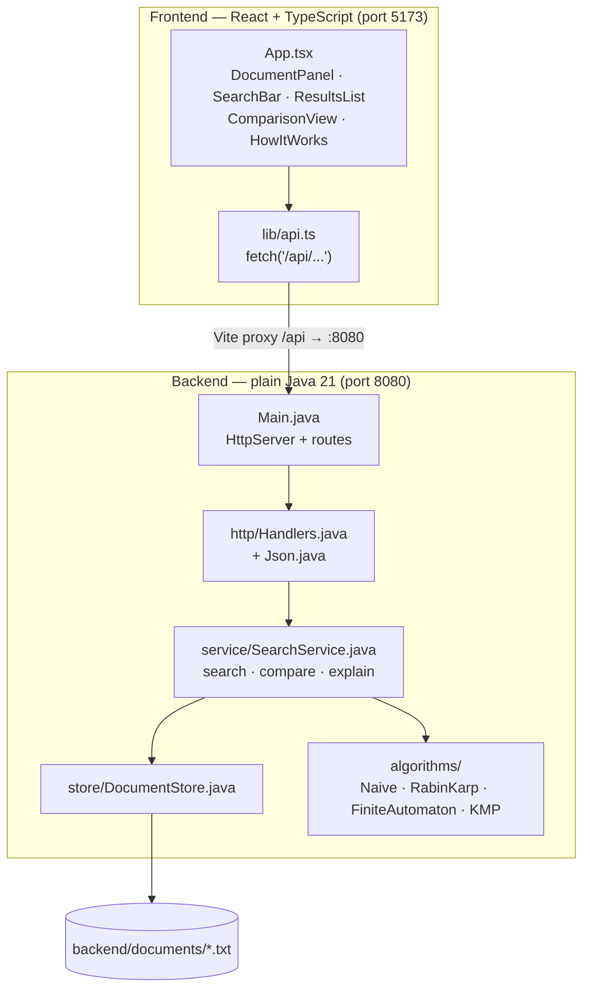
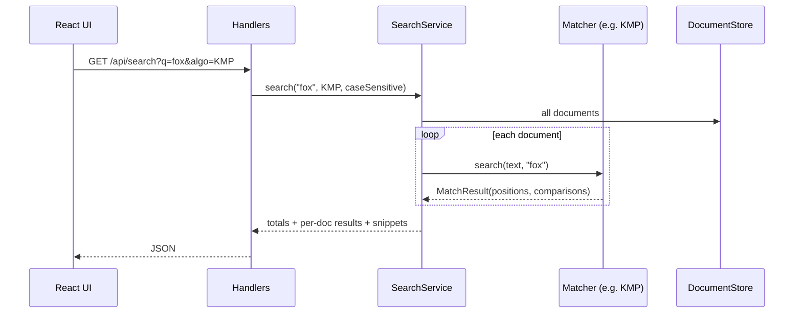
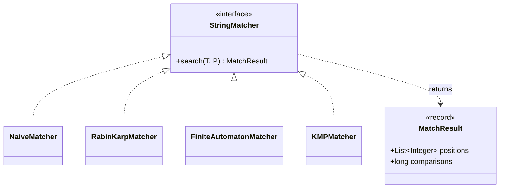

# 1. Project Overview

## What is it?

A **document search engine** built around four classic **string matching algorithms**. You load `.txt` documents and type a pattern, and the engine finds every place the pattern occurs. Its main purpose is to make the algorithms **visible**:

- **Search** with any one of the four algorithms and see every match, with highlighted snippets.
- **Compare** all four on the same search: running time and number of character comparisons.
- **How it works**: see the table each algorithm builds before searching (KMP's π, the automaton's δ, Rabin-Karp's hash values).



## The four algorithms

| Algorithm | Preprocessing | Matching | One-line idea |
|---|---|---|---|
| [Naive](03-naive.md) | none | O((n−m+1)·m) | Try every shift, compare char by char |
| [Rabin-Karp](04-rabin-karp.md) | O(m) | avg O(n+m), worst O((n−m+1)·m) | Compare hashes first, check chars only on a hash hit |
| [Finite Automaton](05-finite-automaton.md) | O(m³·\|Σ\|) | O(n) | Build a state machine, read each text char once |
| [KMP](06-kmp.md) | O(m) | O(n) | Prefix function says how far to shift, the text pointer never goes back |

## Architecture



**Why this shape?**
- The **algorithms** know nothing about HTTP or files. They take two strings and return positions plus a comparison count. That keeps them easy to read and test.
- The **service** handles the "search engine" work: looping over documents, case-insensitivity, timing, and snippets.
- The **HTTP layer** only parses requests and writes JSON.
- The **frontend** never talks to Java directly. The Vite dev server forwards `/api` calls, so there are no CORS issues.

### What happens when you search



## Tech stack

| Part | Choice | Why |
|---|---|---|
| Backend | Java 21, JDK only (`com.sun.net.httpserver`) | No frameworks to learn, everything is visible code |
| JSON | hand-written | No external libraries |
| Frontend | Vite + React + TypeScript | Fast dev server, typed API |
| UI | Tailwind + shadcn/ui | Clean, consistent components |

## Folder layout

```
backend/
  src/searchengine/
    algorithms/      ✅ StringMatcher, MatchResult, Naive, RabinKarp, FiniteAutomaton, KMP
    store/           ✅ DocumentStore (reads/writes documents/*.txt)
    service/         ✅ Algorithm, SearchService (search, compare, explain)
    http/            ✅ Json, Handlers
    Main.java        ✅ HTTP server
  documents/         ✅ sample .txt files
  run.sh / run.ps1   ✅ compile + start
frontend/            ✅ React app (documents, search, results, comparison, how it works)
docs/                ✅ these notes
```

## Build progress

| Step | What | Status |
|---|---|---|
| 1 | Repo setup | ✅ |
| 2 | The four algorithms | ✅ |
| 3 | `DocumentStore` + `SearchService` | ✅ |
| 4 | HTTP API, sample docs, run scripts | ✅ |
| 5 | Frontend scaffold | ✅ |
| 6 | Documents panel, search bar, results | ✅ |
| 7 | Comparison view (table + chart) | ✅ |
| 8 | How-it-works view + polish | ✅ |
| 9 | Dark mode | ✅ |

## The common interface

Every algorithm implements the same interface, so the rest of the app can swap them freely:

```java
public interface StringMatcher {
    MatchResult search(String T, String P);
}

public record MatchResult(List<Integer> positions, long comparisons) { }
```


