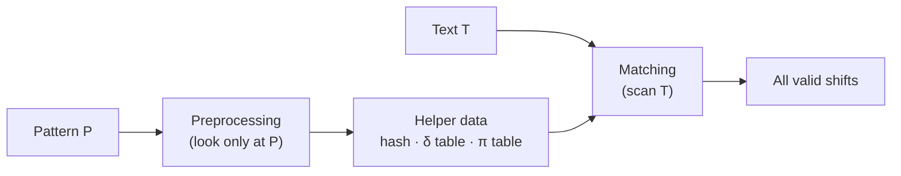

# 2. String Matching Basics

## The problem

> Given a **text** `T[0..n-1]` and a **pattern** `P[0..m-1]`, find **every** position `s` where `P` occurs in `T`.

Formally, `s` is a **valid shift** if `0 ≤ s ≤ n − m` and `T[s .. s+m−1] = P[0 .. m−1]`.

```
index:   0 1 2 3 4 5 6 7 8 9 10
T      = a b a b a b a c a b a
                                       shift s = 2
P      =     a b a b a c a     ←  P sits under T[2..8]: every char matches ✓
```

Some details matter:
- We want **all** matches, not just the first one.
- Matches can **overlap**. In `T = aaaaa`, `P = aa` matches at `0, 1, 2, 3`.
- Positions are **0-based**. CLRS uses 1-based arrays, so CLRS pseudocode indices are 1 higher.

## Shifts: the picture to keep in mind

Every algorithm here slides `P` along `T`. The only question is **how cleverly** it decides where to try next.

```
s = 0   a b a b a c a
s = 1     a b a b a c a
s = 2       a b a b a c a        ← valid
s = 3         a b a b a c a
s = 4           a b a b a c a
T       a b a b a b a c a b a
```

There are `n − m + 1` possible shifts (here `11 − 7 + 1 = 5`).

## Prefixes and suffixes

KMP and the finite automaton are built on these two ideas.

| | Meaning | Example with `"abab"` |
|---|---|---|
| **Prefix** | A piece from the start | `""`, `"a"`, `"ab"`, `"aba"`, `"abab"` |
| **Suffix** | A piece from the end | `""`, `"b"`, `"ab"`, `"bab"`, `"abab"` |
| **Proper** | Not the whole string | |

Notation: `Pₖ` = the first `k` characters of `P`. `x ⊐ y` means "x is a suffix of y".

**Key question both KMP and FA ask:**
> "What is the longest prefix of the pattern that is also a suffix of what I've just read?"

For `"abab"`, the longest proper prefix that is also a suffix is `"ab"` (length 2):

```
a b a b
└─┘          prefix "ab"
    └─┘      suffix "ab"   → same string, length 2
```

That number lets the algorithm **reuse** what it has already matched instead of starting over.

## How we measure cost

Big-O tells you how cost grows. The app also **counts** actual work, so you can see the difference on real text.

| Measure | What it is | Where |
|---|---|---|
| **Time (ms)** | Wall-clock time with `System.nanoTime` | Comparison view |
| **Character comparisons** | How many times a text char is checked against a pattern char | Every search |

Counting rules (the same for all four, so the numbers are comparable):

| Algorithm | What counts as one comparison |
|---|---|
| Naive | each `P[j]` vs `T[s+j]` check |
| Rabin-Karp | only the char checks done to **verify a hash hit** (hash arithmetic is not counted) |
| Finite Automaton | one table lookup `δ(q, T[i])` per text char, so always exactly `n` |
| KMP | each `P[q]` vs `T[i]` check, including the failed ones while falling back |

## Two phases



- **Preprocessing** depends only on the pattern. A search engine can build it once and reuse it for every document.
- **Matching** scans the text. This is where O(n) vs O(n·m) really matters, because documents are long and patterns are short.

## Case-insensitive search

When "case sensitive" is off, the service lowercases **both** `T` and `P` before calling the matcher. The algorithms themselves always match exactly.
