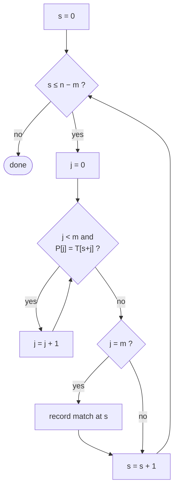

# 3. Naive (Brute-Force) Matching

📄 Code: [`NaiveMatcher.java`](../backend/src/searchengine/algorithms/NaiveMatcher.java)

## Idea

Try **every** shift `s` from `0` to `n − m`. At each shift, compare the pattern with the text one character at a time. Stop at the first mismatch. If all `m` characters match, `s` is a valid shift.

There is no preprocessing and no memory of earlier shifts. Every shift starts again from scratch.



## Pseudocode (CLRS `NAIVE-STRING-MATCHER`, 0-based)

```
for s = 0 to n − m
    if P[0..m−1] == T[s..s+m−1]      // compared char by char, stop at first mismatch
        report s
```

## Walk-through on the running example

`T = abababacaba`, `P = ababaca`. ✓ = match, ✗ = mismatch, and each mark is one comparison.

```
index:    0 1 2 3 4 5 6 7 8 9 10
T       = a b a b a b a c a b a

s = 0     a b a b a c                 ✓✓✓✓✓✗   6 comparisons  (c ≠ b)
s = 1       a                         ✗        1              (a ≠ b)
s = 2         a b a b a c a           ✓✓✓✓✓✓✓  7  → MATCH at 2
s = 3           a                     ✗        1              (a ≠ b)
s = 4             a b a b             ✓✓✓✗     4              (b ≠ c)
                                               ──
                                               19 comparisons
```

Look at shift 0: we matched `ababa` and then failed. Naive then moves to shift 1 and checks `T[1]` **again**, even though we already knew what it was. KMP and the finite automaton are designed to avoid exactly this repeated work.

## Complexity

| | Cost |
|---|---|
| Preprocessing | none |
| Matching (worst) | **O((n − m + 1) · m)** |
| Extra memory | O(1) |

**Worst case:** `T = aaaa…a`, `P = aa…ab`. Every shift matches `m − 1` chars before failing, so the cost is about `(n − m + 1) · m`.

```
T = a a a a a a a a
P = a a b                ✓✓✗  at every shift → m comparisons per shift
```

**Typical case on real English text:** usually the first character already mismatches, so Naive is often close to `n` comparisons and runs fast in practice. That is why it can look "not that bad" on small or random inputs.

## When to use it

- Very short patterns or texts
- When simplicity matters more than guaranteed speed
- As the **baseline** to measure the other algorithms against
