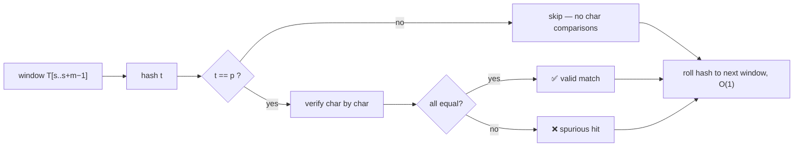

# 4. Rabin-Karp Matching

📄 Code: [`RabinKarpMatcher.java`](../backend/src/searchengine/algorithms/RabinKarpMatcher.java)

## Idea

Comparing two `m`-character strings costs up to `m` steps. Comparing two **numbers** costs 1 step. So:

1. Turn the pattern into a number, its **hash** `p`.
2. Turn each `m`-character window of the text into a number `t`.
3. Only when `p == t` (a **hit**) do we actually compare characters.

The trick that makes this fast is the **rolling hash**: the hash of the next window comes from the previous one in **O(1)**, without re-reading all `m` characters.



## Strings as numbers

Think of a string as a number written in base `d`. With decimal digits (`d = 10`), the string `"31415"` **is** the number 31415.

```
"31415" = 3·10⁴ + 1·10³ + 4·10² + 1·10¹ + 5·10⁰
```

For real text we use `d = 256` (one "digit" per character code). These numbers get huge, so we keep everything **modulo a prime `q`**. Our code uses `q = 101`.

| Symbol | Meaning | In our code |
|---|---|---|
| `d` | radix (alphabet size) | `256` |
| `q` | prime modulus | `101` |
| `h` | `d^(m−1) mod q`, the weight of the leftmost char | `computeH(m)` |
| `p` | hash of the pattern | `patternHash(P)` |
| `t` | hash of the current text window | rolling |

**Horner's rule** computes a hash in O(m):
```
value = 0
for each char c:  value = (d · value + c) mod q
```

## The rolling hash

Going from window `s` to window `s+1` means **removing** the leftmost char and **adding** a new char on the right:

```
window s   :  [ T[s]  T[s+1] … T[s+m−1] ]
window s+1 :          [ T[s+1] … T[s+m−1]  T[s+m] ]
                 ↑ drop                       ↑ add
```

```
t(s+1) = ( d · ( t(s) − T[s]·h ) + T[s+m] )  mod q
              └── remove leading char ──┘   └ shift left, add new char
```

In Java `%` can return a negative number, so we add `q` when `t < 0`.

**Decimal example (CLRS):** `d = 10`, `q = 13`, `h = 10⁴ mod 13 = 3`. Rolling from window `31415` (hash 7) to `14152`:
```
t = (10 · (7 − 3·3) + 2) mod 13 = (−18) mod 13 = −5 → −5 + 13 = 8
check: 14152 mod 13 = 8 ✓
```

## Hits and spurious hits

Same hash does **not** guarantee the same string, because many numbers share a remainder mod `q`. CLRS example with `T = 2359023141526739921`, `P = 31415`, `q = 13`, `p = 7`:

| s | 0 | 1 | 2 | 3 | 4 | 5 | **6** | 7 | 8 | 9 | 10 | 11 | **12** | 13 | 14 |
|---|---|---|---|---|---|---|---|---|---|---|---|---|---|---|---|
| window | 23590 | 35902 | 59023 | 90231 | 02314 | 23141 | **31415** | 14152 | 41526 | 15267 | 52673 | 26739 | **67399** | 73992 | 39921 |
| hash | 8 | 9 | 3 | 11 | 0 | 1 | **7** ✅ | 8 | 4 | 5 | 10 | 11 | **7** ❌ | 9 | 11 |

- `s = 6`: hash 7 = p, and the chars match, so it is a **valid match**.
- `s = 12`: hash 7 = p, but `67399 ≠ 31415`, so it is a **spurious hit**.

Only 2 of the 15 windows need character checks. The spurious one costs some wasted comparisons but never gives a wrong answer, because we always verify.

## Walk-through on the running example (real values from our code)

`P = ababaca`, `d = 256`, `q = 101`, `m = 7`. Character codes: `a = 97`, `b = 98`, `c = 99`.

**Preprocessing:** `h = 256⁶ mod 101 = 25`, `p = 51`.

| s | window | hash t | t == p ? | char comparisons |
|---|---|---|---|---|
| 0 | `abababa` | 98 | no | 0 |
| 1 | `bababac` | 85 | no | 0 |
| 2 | `ababaca` | **51** | **yes → verify** | 7 → ✅ match |
| 3 | `babacab` | 71 | no | 0 |
| 4 | `abacaba` | 2 | no | 0 |
| | | | **total** | **7** |

Rolling step from `s = 0` to `s = 1` (drop `a = 97`, add `T[7] = c = 99`):
```
t = (256 · (98 − 97·25) + 99) mod 101
  = (256 · (−2327) + 99) mod 101
  = −595613 mod 101 = −16  →  −16 + 101 = 85 ✓
```

Compare: Naive used **19** comparisons, Rabin-Karp used **7**.

## Complexity

| | Cost |
|---|---|
| Preprocessing | **O(m)**: compute `h`, `p`, and the first `t` |
| Matching (average) | **O(n + m)**, when spurious hits are rare |
| Matching (worst) | **O((n − m + 1) · m)**, when every window is a hit (e.g. `T = aaaa…`, `P = aaa`) |

A bigger prime `q` makes spurious hits rarer. We use `101` so the numbers stay small enough to show in the UI.

## When to use it

- Searching for **many patterns at once** (hash them all and look each window up in a set)
- Plagiarism / duplicate detection (comparing many substrings by hash)
