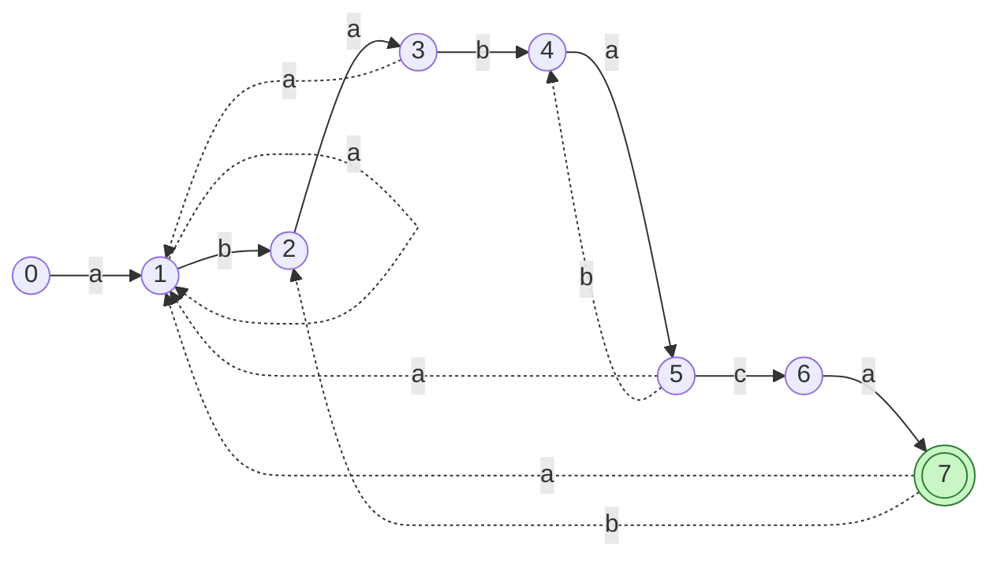

# 5. Finite Automaton Matching

📄 Code: [`FiniteAutomatonMatcher.java`](../backend/src/searchengine/algorithms/FiniteAutomatonMatcher.java)

## Idea

Build a small **state machine** from the pattern, then feed it the text **one character at a time**. The machine always knows how much of the pattern it has matched so far:

> **State `q`** = "the last `q` characters I read are the first `q` characters of P"

- Start in state `0` (nothing matched).
- Read character `a`, then jump to state `δ(q, a)` using a precomputed table.
- Reaching state `m` means the whole pattern was just read, so there is a **match** ending here.

Every text character is read **exactly once** and the machine never goes back, so matching is **O(n)**.

## The automaton for `P = ababaca`

States `0 … 7`. Solid arrows move forward (one more char matched). Dotted arrows fall back to a shorter match. **Every transition not drawn goes to state 0.**



State **7** (double circle) is the accepting state, which means a match was found.

## The transition table δ

The alphabet Σ is the distinct characters of the pattern (`a`, `b`, `c`) plus one **"other"** column for any other character. A character that isn't in the pattern can't continue any match, so "other" always leads to state 0. This keeps the table small enough to show in the UI.

| state q | prefix matched | a | b | c | other |
|---|---|---|---|---|---|
| 0 | `""` | **1** | 0 | 0 | 0 |
| 1 | `a` | 1 | **2** | 0 | 0 |
| 2 | `ab` | **3** | 0 | 0 | 0 |
| 3 | `aba` | 1 | **4** | 0 | 0 |
| 4 | `abab` | **5** | 0 | 0 | 0 |
| 5 | `ababa` | 1 | 4 | **6** | 0 |
| 6 | `ababac` | **7** | 0 | 0 | 0 |
| 7 ✅ | `ababaca` | 1 | 2 | 0 | 0 |

**Bold** = moving forward along the pattern. (This is exactly CLRS Figure 32.7.)

## How each entry is computed

> **δ(q, a)** = the length of the **longest prefix of P** that is a **suffix of `Pq` followed by `a`**.

In words: "I had matched `q` chars, then I read `a`. How much of the pattern is still in play?"

**Example: δ(5, b)**
```
Pq·a    = a b a b a + b  =  a b a b a b
Try k=6:  P6 = a b a b a c   vs last 6 = a b a b a b   no
Try k=5:  P5 = a b a b a     vs last 5 = b a b a b     no
Try k=4:  P4 = a b a b       vs last 4 = a b a b       YES  → δ(5, b) = 4
```

**Example: δ(7, b)** (after a full match, keep going so overlapping matches are found)
```
Pq·a = a b a b a c a b    → longest prefix of P that is a suffix = "ab"  → 2
```

### Pseudocode (CLRS `COMPUTE-TRANSITION-FUNCTION`)
```
for q = 0 to m
    for each character a in Σ
        k = min(m + 1, q + 2)
        repeat  k = k − 1
        until   Pk is a suffix of Pq·a
        δ(q, a) = k
```

Why `q + 2`? From state `q`, reading one char can increase the match by **at most 1**, so `k ≤ q + 1`. The loop decrements first, so it starts one higher.

## Matching: walk-through on the running example

`T = abababacaba`. One table lookup per character means **11 comparisons** (always exactly `n`).

| i | T[i] | state before | δ | state after | |
|---|---|---|---|---|---|
| 0 | a | 0 | δ(0,a) | 1 | |
| 1 | b | 1 | δ(1,b) | 2 | |
| 2 | a | 2 | δ(2,a) | 3 | |
| 3 | b | 3 | δ(3,b) | 4 | |
| 4 | a | 4 | δ(4,a) | 5 | |
| 5 | b | 5 | δ(5,b) | **4** | fell back, but still kept `abab` |
| 6 | a | 4 | δ(4,a) | 5 | |
| 7 | c | 5 | δ(5,c) | 6 | |
| 8 | a | 6 | δ(6,a) | **7** | ✅ match at shift `8 − 7 + 1 = 2` |
| 9 | b | 7 | δ(7,b) | 2 | |
| 10 | a | 2 | δ(2,a) | 3 | |

At `i = 5` Naive would restart from scratch. The automaton already "knows" (it's in the table) that `abab` is still matched.

```
matching:
for i = 0 to n − 1
    q = δ(q, T[i])
    if q == m:  report shift i − m + 1
```

## Complexity

| | Cost |
|---|---|
| Preprocessing | **O(m³ · \|Σ\|)**: (m+1) states × \|Σ\| chars × up to m values of k × an O(m) suffix check |
| Matching | **O(n)**: exactly one lookup per text char |
| Memory | (m+1) × (\|Σ\|+1) table |

Faster preprocessing (O(m·|Σ|)) is possible using the prefix function π. That's the link to KMP, which drops the table altogether.

## When to use it

- The same pattern is searched across **lots of text** (build once, then each char costs O(1))
- Hardware / streaming settings where you can only read each input char once
- It is also the basis of regular-expression engines
