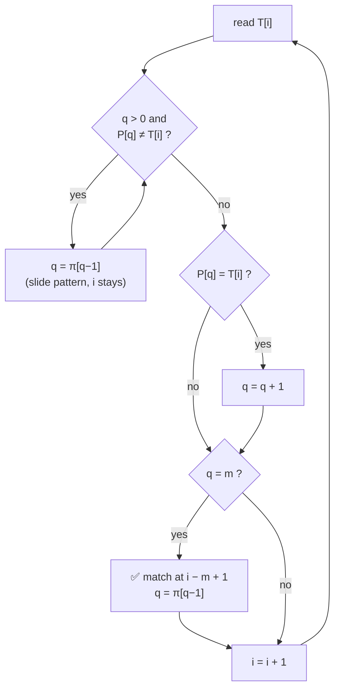

# 6. Knuth-Morris-Pratt (KMP) Matching

📄 Code: [`KMPMatcher.java`](../backend/src/searchengine/algorithms/KMPMatcher.java)

## Idea

When a mismatch happens after matching `q` characters, we **already know** those `q` text characters, because they equal `P[0..q−1]`. So we can work out **from the pattern alone** how far to slide it, and we never need to re-read the text.

The **prefix function π** stores that answer for every `q`:

> **π[q]** = length of the longest **proper prefix** of `P[0..q]` that is also a **suffix** of `P[0..q]`.

KMP is like the finite automaton, but instead of a full table δ(q, every char) it keeps just **one number per state**. That makes preprocessing **O(m)** instead of O(m³·|Σ|).

## The prefix function for `P = ababaca`

| q | 0 | 1 | 2 | 3 | 4 | 5 | 6 |
|---|---|---|---|---|---|---|---|
| P[q] | a | b | a | b | a | c | a |
| **π[q]** | 0 | 0 | 1 | 2 | 3 | 0 | 1 |

(Same as CLRS Figure 32.10, but 0-based.)

Reading the table:
```
q = 4:   P[0..4] = a b a b a
                   └───┘          prefix "aba"
                       └───┘      suffix "aba"     → π[4] = 3

q = 5:   P[0..5] = a b a b a c    nothing that starts with 'a' ends with 'c' → π[5] = 0
```

## Computing π (CLRS `COMPUTE-PREFIX-FUNCTION`)

`k` = length of the current border (prefix that is also a suffix). For each new char `P[q]`, try to extend `k`. If that fails, fall back to `π[k−1]` and try again.

```
π[0] = 0,  k = 0
for q = 1 to m − 1
    while k > 0 and P[k] ≠ P[q]:   k = π[k − 1]     // fall back
    if P[k] == P[q]:               k = k + 1        // extend
    π[q] = k
```

Trace:

| q | P[q] | what happens | π[q] |
|---|---|---|---|
| 1 | b | k=0: P[0]=a ≠ b | 0 |
| 2 | a | P[0]=a = a → k=1 | 1 |
| 3 | b | P[1]=b = b → k=2 | 2 |
| 4 | a | P[2]=a = a → k=3 | 3 |
| 5 | c | P[3]=b ≠ c → k=π[2]=1; P[1]=b ≠ c → k=π[0]=0; P[0]=a ≠ c | 0 |
| 6 | a | P[0]=a = a → k=1 | 1 |

Notice π is computed by **matching the pattern against itself**, which is the same loop as the matcher below.

## Matching (CLRS `KMP-MATCHER`)

```
q = 0                                   // chars matched so far
for i = 0 to n − 1
    while q > 0 and P[q] ≠ T[i]:  q = π[q − 1]     // mismatch: slide pattern
    if P[q] == T[i]:              q = q + 1        // match: extend
    if q == m:
        report shift i − m + 1
        q = π[q − 1]                               // keep looking (overlaps)
```



## The key moment, drawn

`T = abababacaba`. After matching `ababa` (q = 5), we read `T[5] = b` but `P[5] = c`. Mismatch.

```
index:   0 1 2 3 4 5 6 7 8 9 10
T      = a b a b a b a c a b a
                   ↑ i = 5
before:  a b a b a c                 q = 5, P[5]=c ≠ b  ✗

π[4] = 3 → keep "aba", slide pattern right by 5 − 3 = 2

after:       a b a b a c a           q = 3, P[3]=b = b  ✓  → q = 4
             └───┘ already known to match, so not re-checked
```

Naive would slide by **1** and re-check `T[1], T[2], …`. KMP slides by **2** and keeps the text pointer `i` at 5.

## Full walk-through: 12 comparisons

| i | T[i] | q before | comparisons made | q after |
|---|---|---|---|---|
| 0 | a | 0 | P[0]=a ✓ | 1 |
| 1 | b | 1 | P[1]=b ✓ | 2 |
| 2 | a | 2 | P[2]=a ✓ | 3 |
| 3 | b | 3 | P[3]=b ✓ | 4 |
| 4 | a | 4 | P[4]=a ✓ | 5 |
| 5 | b | 5 | P[5]=c ✗ → q=π[4]=3, then P[3]=b ✓ | 4 |
| 6 | a | 4 | P[4]=a ✓ | 5 |
| 7 | c | 5 | P[5]=c ✓ | 6 |
| 8 | a | 6 | P[6]=a ✓ → **match at 2**, q=π[6]=1 | 1 |
| 9 | b | 1 | P[1]=b ✓ | 2 |
| 10 | a | 2 | P[2]=a ✓ | 3 |

Total = 11 + 1 extra (the failed check at i = 5) = **12**.

## Why it's O(n): the amortized argument

- `q` goes **up** by at most 1 per text char, so it rises at most `n` times in total.
- Each `q = π[q−1]` makes `q` go **down** by at least 1.
- `q` can't go below 0, so the total number of fall-backs ≤ total rises ≤ `n`.

That gives at most about `2n` comparisons, so matching is **O(n)**. The same argument makes computing π **O(m)**.

## Complexity

| | Cost |
|---|---|
| Preprocessing | **O(m)** (prefix function) |
| Matching | **O(n)** (worst case too, ≤ 2n comparisons) |
| Memory | O(m) for π |

## KMP vs Finite Automaton

| | Finite Automaton | KMP |
|---|---|---|
| Stores | full table δ(q, a) | one number π[q] per state |
| Preprocessing | O(m³·\|Σ\|) | O(m) |
| Work per text char | exactly 1 lookup | amortized O(1) (may fall back several times) |
| Depends on alphabet size | yes | no |
