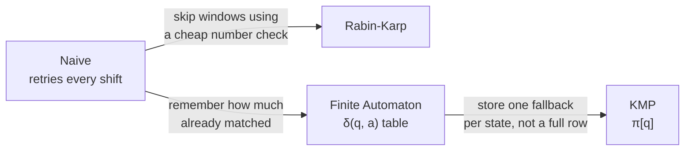

# 7. Comparing the Algorithms

## Summary table

| | Naive | Rabin-Karp | Finite Automaton | KMP |
|---|---|---|---|---|
| **Preprocessing** | none | O(m) | O(m³·\|Σ\|) | O(m) |
| **Matching (worst)** | O((n−m+1)·m) | O((n−m+1)·m) | O(n) | O(n) |
| **Matching (typical)** | ≈ O(n) on normal text | O(n + m) | O(n) | O(n) |
| **Extra memory** | O(1) | O(1) | O(m·\|Σ\|) | O(m) |
| **Text pointer goes back?** | yes | yes (on verify) | never | never |
| **Built on** | brute force | hashing | state machine | prefix function |

## How they relate



## Comparisons on the running example

`T = abababacaba` (n = 11), `P = ababaca` (m = 7), one match at shift 2:

```
Naive             ███████████████████   19
KMP               ████████████          12
Finite Automaton  ███████████           11   (always exactly n)
Rabin-Karp        ███████                7   (only one hash hit to verify)
```

## Edge cases (all four give the same positions)

| Text | Pattern | Matches | Naive | Rabin-Karp | FA | KMP |
|---|---|---|---|---|---|---|
| `aaaaa` | `aa` | 0,1,2,3 | 8 | 8 | 5 | 5 |
| `hello world` | `xyz` | none | 9 | 0 | 11 | 11 |
| `abc` | `abc` | 0 | 3 | 3 | 3 | 3 |
| `ab` | `abc` | none (m > n) | 0 | 0 | 0 | 0 |
| `abc` | `""` | none (empty pattern) | 0 | 0 | 0 | 0 |

## ⚠️ "Naive always does the most comparisons" is NOT always true

Look at `hello world` / `xyz` above: **Naive 9, KMP 11**. Why?

- When the first pattern char almost never matches, Naive does about **1 comparison per shift** and there are only `n − m + 1` shifts.
- FA always does exactly `n`. KMP does at least `n`.

Naive's weakness only shows when there are **many partial matches**, which happens with repetitive text or patterns:

```
T = aaaaaaaaaaaaaaaaaaab   (n = 20)
P = aaaab                  (m = 5, match at 15)

Naive             ████████████████████████████████████████   80   ≈ (n−m+1)·m
KMP               ██████████████████                         35   ≤ 2n
Finite Automaton  ██████████                                 20   = n
Rabin-Karp        ███                                         5   (one hit)
```

On real documents with a reasonably long pattern, Naive usually ends up highest, and the gap grows with repetition. The **Comparison** tab in the app lets you try this yourself.

## Comparisons vs. time

Comparison counts measure the **algorithm**. Milliseconds also measure the **machine**: the JIT compiler, caches, and object allocation. On small documents:
- Naive can be fastest in ms despite more comparisons, because its loop is very simple.
- The finite automaton pays for building its table first.
- Rabin-Karp does modular arithmetic for every window, even with no hits.

That's why the app reports **both**, and runs a warm-up pass before timing (so the JIT has compiled the code).

## Which one would you pick?

| Situation | Best choice |
|---|---|
| Tiny inputs, quick script | Naive |
| Many patterns at once / substring fingerprints | Rabin-Karp |
| Same pattern over a huge stream, small alphabet | Finite Automaton |
| General-purpose, guaranteed linear time | **KMP** |
