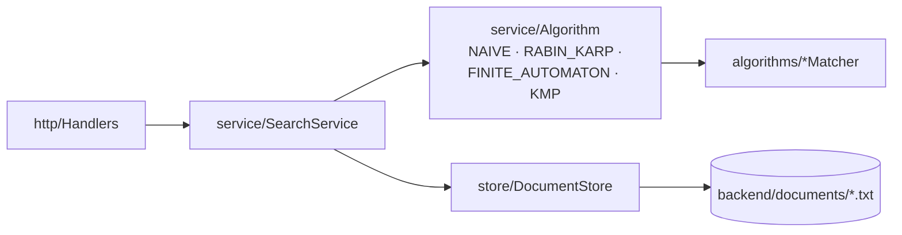
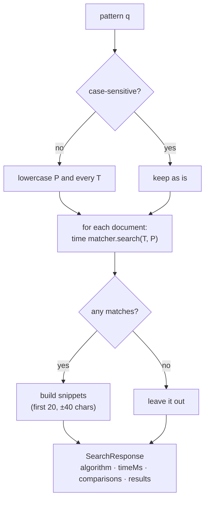
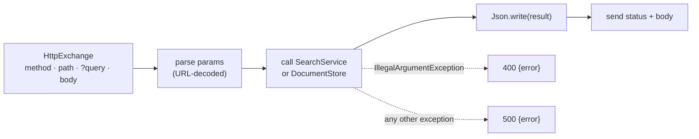

# 8. Backend: Store, Service and HTTP API

The algorithms only know how to search **one string** for **one pattern**. The backend turns them into a **search engine**: it keeps a folder of documents, runs a matcher over all of them, and answers HTTP requests from the UI.



## 8.1 DocumentStore: documents are just files

`store/DocumentStore.java` keeps every document as a `.txt` file in one folder. There's no database. The folder **is** the database.

| Method | What it does |
|---|---|
| `all()` | Reads every `*.txt` file, sorted by name |
| `save(name, text)` | Cleans the name, then writes the file (same name = overwrite) |
| `delete(id)` | Deletes `id + ".txt"`, returns `false` if it wasn't there |

A document is a small record:

```java
public record Document(String id, String name, String text) { }
```

The **id** is the file name without `.txt`, so `dna-sample.txt` has id `dna-sample`.

### Cleaning file names (safety)

The name comes from the user, so it's cleaned before it touches the disk:

| Input name | Saved as |
|---|---|
| `My Notes!.txt` | `My-Notes.txt` (spaces → `-`, `!` dropped) |
| `t2` | `t2.txt` (`.txt` added) |
| `...` | rejected: "Invalid document name" |

`delete` only accepts ids made of letters, digits, `.`, `_` and `-`, so a request like `DELETE /api/documents/../x` can't escape the folder.

## 8.2 Algorithm: choosing a matcher by name

The API's `algo` parameter is a string like `KMP`. `service/Algorithm.java` is an `enum` that maps that name to a matcher object plus a short description and its complexity:

```java
KMP(new KMPMatcher(), "Preprocessing: O(m). Matching: O(n)", "Computes the prefix function π ...")
```

`Algorithm.parse("rabin_karp")` → `RABIN_KARP` (case doesn't matter). Unknown names give an error, which the HTTP layer turns into a `400 Bad Request`.

## 8.3 SearchService: the three operations

### search(q, algo, caseSensitive)



Details worth knowing:

- **Case-insensitive search** lowercases both text and pattern **one character at a time**. Java's `String.toLowerCase()` can change a string's length for a few special characters (e.g. `İ`), and then match positions would no longer line up with the original text. Char by char, the length never changes.
- **Snippets come from the original text**, so a case-insensitive search for `fox` still shows `Fox` with its capital letter.
- **Only the matcher call is timed**, not the lowercasing or snippet building. `timeMs` is the sum over all documents, rounded to 3 decimals.
- Documents with **zero matches are left out** of `results`, but their comparisons still count towards the total.
- Patterns longer than **100 characters** are rejected. The finite automaton's preprocessing is O(m³·|Σ|), so a very long pattern would make it hang.

Example, run on a document containing `The quick brown Fox jumps over the lazy dog.⏎The fox again.` with KMP:

| caseSensitive | count | positions | first snippet |
|---|---|---|---|
| false | 2 | 16, 49 | `The quick brown ` **Fox** ` jumps over the lazy dog. The fox again.` |
| true | 1 | 49 | ` brown Fox jumps over the lazy dog. The ` **fox** ` again.` |

(The newline in the snippet is turned into a space so it fits on one line.)

### compare(q, caseSensitive)

Runs **all four** algorithms on the same documents and pattern:

1. **Warm-up pass:** run every matcher once and throw the result away. Java's JIT compiler turns hot code into fast machine code while it runs. Without a warm-up, whichever algorithm runs first would look slow.
2. **Timed pass:** run each algorithm over every document, adding up time, comparisons and matches.

One result row per algorithm: `{algorithm, timeMs, comparisons, totalMatches}`. All four should always report the **same** `totalMatches`. If they didn't, one of them would have a bug.

### explain(q, algo)

Returns the algorithm's description, its complexity, and the **preprocessing for this exact pattern**, using the public helpers in each matcher:

| Algorithm | `preprocessing` contains | Helper used |
|---|---|---|
| Naive | just `pattern`, `m` (no preprocessing) | – |
| Rabin-Karp | `d`, `q`, `h`, `p` | `computeH`, `patternHash` |
| Finite Automaton | `alphabet` (Σ + `"other"`), `delta` (m+1 rows) | `alphabet`, `computeTransitionFunction` |
| KMP | `pi` | `computePrefixFunction` |

For `q = ababaca` this gives π = `[0, 0, 1, 2, 3, 0, 1]` (the CLRS example) and, for Rabin-Karp, `h = 25`, `p = 51`.

## 8.4 The HTTP layer

Java has a small web server built in: `com.sun.net.httpserver.HttpServer`. No framework is needed.

```java
HttpServer server = HttpServer.create(new InetSocketAddress(8080), 0);
server.createContext("/api/documents", handlers::documents);
server.createContext("/api/search",    handlers::search);
server.createContext("/api/compare",   handlers::compare);
server.createContext("/api/explain",   handlers::explain);
server.start();
```

A **context** is a path prefix. Every request whose path starts with `/api/documents` (including `/api/documents/dna-sample`) goes to `handlers.documents(...)`. No executor is set, so requests are handled **one at a time**. That's enough here, and it means two uploads can never write the same file at once.

### Handlers: request in, JSON out

Every route in `http/Handlers.java` follows the same three steps:



The routes share one `run(...)` helper that catches exceptions. The service throws `IllegalArgumentException` for bad input (missing `q`, unknown `algo`, pattern too long), and `run` turns it into a `400` with a JSON message. So the service never has to know about HTTP status codes.

| Request | Status | Body |
|---|---|---|
| `GET /api/documents` | 200 | `[{id,name,size}]` (`size` = number of characters) |
| `POST /api/documents?name=My%20Test%20File.txt` | 201 | `{"id":"My-Test-File","name":"My-Test-File.txt","size":34}` |
| `DELETE /api/documents/My-Test-File` | 204 | (none) |
| same DELETE again | 404 | `{"error":"No document with id My-Test-File"}` |
| `GET /api/search?q=x&algo=BOYER` | 400 | `{"error":"Unknown algorithm: BOYER"}` |
| `GET /api/search?algo=KMP` | 400 | `{"error":"Missing parameter: q"}` |
| a 101-character pattern | 400 | `{"error":"Pattern is longer than 100 characters"}` |
| `POST` with an empty body | 400 | `{"error":"The document is empty"}` |
| `PUT /api/documents` | 405 | `{"error":"Method not allowed"}` |

**URL encoding:** a pattern like `Ctrl+F` must be sent as `q=Ctrl%2BF`, because a bare `+` in a query string means a space. The frontend will use `encodeURIComponent`, which does this automatically.

### Json: a writer in ~100 lines

There's no JSON library, so `http/Json.java` builds the text by hand. It looks at the type of each value:

| Java value | JSON |
|---|---|
| `null` | `null` |
| `String` | `"..."` with `"` `\` and control chars escaped (`\n`, `\t`, `\u0001`...) |
| `Integer`, `Long`, `Double`, `Boolean` | written as is |
| `Map` | `{ "key": value, ... }` |
| `List`, `int[]`, `int[][]` | `[ ... ]` |
| a **record** | `{ "component": value, ... }`, using the record's component names |

The record rule does most of the work. `SearchResponse(String algorithm, double timeMs, ...)` becomes `{"algorithm":...,"timeMs":...}` with no extra code. Java's reflection lists a record's components in declaration order (`getRecordComponents()`), and each one has an accessor method to read its value. So **the record's field names are the API's field names**.

## 8.5 Running it

```bash
cd backend && ./run.sh        # Windows: .\run.ps1
```

Both scripts do the same thing: delete `out/`, compile every `.java` file under `src/` with `javac`, then run `java -cp out searchengine.Main documents`. The last argument is the documents folder.

## 8.6 Sample documents

`backend/documents/` ships with four files, each picked to show something different:

| File | Characters | Why it's there |
|---|---|---|
| `dna-sample.txt` | 12,200 | Alphabet of only 4 letters (ACGT), with the motif `GATTACA` planted in it. Lots of partial matches |
| `repetitive.txt` | 5,668 | 200 runs of 15–40 `a`s, each ending in `b`. This is Naive's worst case |
| `string-matching.txt` | 3,727 | Normal English prose (about this topic) |
| `the-tortoise-and-the-hare.txt` | 2,335 | A short story, good for words like `fox` and `the` |

`.gitattributes` keeps these files (and `run.sh`) with Unix `\n` line endings on every OS. Otherwise Windows would check them out with `\r\n`, the sizes and match positions would change, and `run.sh` would break.

## 8.7 Real numbers from the API

`GET /api/compare` on the four sample documents (case-insensitive unless noted). Total text length n = 23,930 characters, which is exactly the Finite Automaton's comparison count every time.

| Pattern | Matches | Naive | Rabin-Karp | Finite Automaton | KMP |
|---|---|---|---|---|---|
| `the` | 134 | 27,615 | 428 | 23,930 | 27,309 |
| `fox` | 7 | 24,057 | 256 | 23,930 | 24,036 |
| `GATTACA` (case-sensitive) | 7 | 27,899 | 243 | 23,930 | 26,916 |
| `aaaaaaaaaab` | 200 | **73,954** | 2,455 | 23,930 | 30,830 |

What this shows:

- **Finite Automaton = n**, always. It does one table lookup per text character, no matter what the pattern is.
- On normal text (`the`, `fox`), **Naive and KMP are close**. Most shifts fail on the first character, so Naive rarely re-reads anything.
- On repetitive text (`aaaaaaaaaab`), **Naive more than doubles KMP's count**. Every run of `a`s gives Naive many long partial matches that it throws away and re-checks one shift later.
- **Rabin-Karp** counts only the characters it checks after a hash hit. That's why its number is so small. Its real cost is the rolling-hash arithmetic, which happens once per window but isn't a character comparison.

### Why the milliseconds jump around

Two runs of `compare?q=the`:

| | Naive | Rabin-Karp | FA | KMP |
|---|---|---|---|---|
| right after the server started | 5.095 ms | 7.170 ms | 11.619 ms | 3.037 ms |
| after a few other requests | 0.811 ms | 0.688 ms | 1.095 ms | 0.706 ms |

The comparison counts were the same both times. Only the time changed. On the first request the JIT compiler hasn't optimised the code yet, so everything is slower. One warm-up pass helps, but it can't fully remove the effect. That's why **comparisons** are the reliable way to compare the algorithms, and the time in ms is a rough guide.
