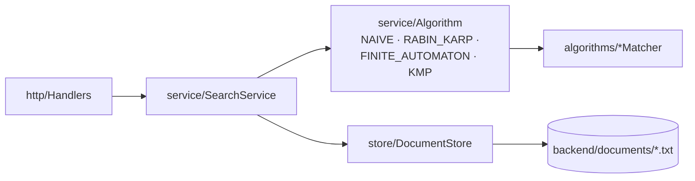
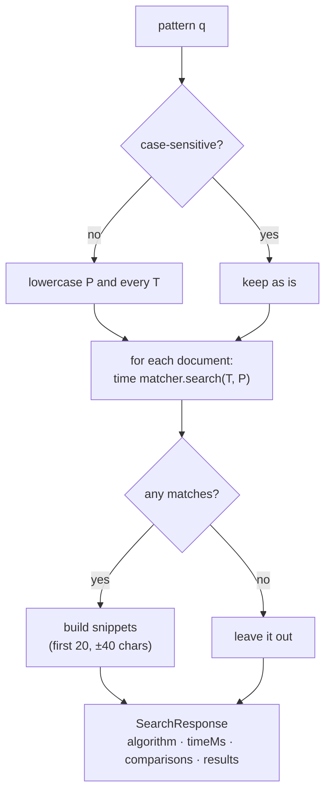

# 8. Backend: Store, Service and HTTP API

The algorithms only know how to search **one string** for **one pattern**. The backend turns them into a **search engine**: it keeps a folder of documents, runs a matcher over all of them, and answers HTTP requests from the UI.



## 8.1 DocumentStore: documents are just files

`store/DocumentStore.java` keeps every document as a `.txt` file in one folder. There's no database. The folder **is** the database.

| Method | What it does |
|---|---|
| `all()` | Reads every `*.txt` file, sorted by name |
| `save(name, text)` | Cleans the name, then writes the file (same name = overwrite) |
| `delete(id)` | Deletes `id + ".txt"`, returns `false` if it wasn't there |

A document is a small record:

```java
public record Document(String id, String name, String text) { }
```

The **id** is the file name without `.txt`, so `dna-sample.txt` has id `dna-sample`.

### Cleaning file names (safety)

The name comes from the user, so it's cleaned before it touches the disk:

| Input name | Saved as |
|---|---|
| `My Notes!.txt` | `My-Notes.txt` (spaces → `-`, `!` dropped) |
| `t2` | `t2.txt` (`.txt` added) |
| `...` | rejected: "Invalid document name" |

`delete` only accepts ids made of letters, digits, `.`, `_` and `-`, so a request like `DELETE /api/documents/../x` can't escape the folder.

## 8.2 Algorithm: choosing a matcher by name

The API's `algo` parameter is a string like `KMP`. `service/Algorithm.java` is an `enum` that maps that name to a matcher object plus a short description and its complexity:

```java
KMP(new KMPMatcher(), "Preprocessing: O(m). Matching: O(n)", "Computes the prefix function π ...")
```

`Algorithm.parse("rabin_karp")` → `RABIN_KARP` (case doesn't matter). Unknown names give an error, which the HTTP layer turns into a `400 Bad Request`.

## 8.3 SearchService: the three operations

### search(q, algo, caseSensitive)



Details worth knowing:

- **Case-insensitive search** lowercases both text and pattern **one character at a time**. Java's `String.toLowerCase()` can change a string's length for a few special characters (e.g. `İ`), and then match positions would no longer line up with the original text. Char by char, the length never changes.
- **Snippets come from the original text**, so a case-insensitive search for `fox` still shows `Fox` with its capital letter.
- **Only the matcher call is timed**, not the lowercasing or snippet building. `timeMs` is the sum over all documents, rounded to 3 decimals.
- Documents with **zero matches are left out** of `results`, but their comparisons still count towards the total.
- Patterns longer than **100 characters** are rejected. The finite automaton's preprocessing is O(m³·|Σ|), so a very long pattern would make it hang.

Example, run on a document containing `The quick brown Fox jumps over the lazy dog.⏎The fox again.` with KMP:

| caseSensitive | count | positions | first snippet |
|---|---|---|---|
| false | 2 | 16, 49 | `The quick brown ` **Fox** ` jumps over the lazy dog. The fox again.` |
| true | 1 | 49 | ` brown Fox jumps over the lazy dog. The ` **fox** ` again.` |

(The newline in the snippet is turned into a space so it fits on one line.)

### compare(q, caseSensitive)

Runs **all four** algorithms on the same documents and pattern:

1. **Warm-up pass:** run every matcher once and throw the result away. Java's JIT compiler turns hot code into fast machine code while it runs. Without a warm-up, whichever algorithm runs first would look slow.
2. **Timed pass:** run each algorithm over every document, adding up time, comparisons and matches.

One result row per algorithm: `{algorithm, timeMs, comparisons, totalMatches}`. All four should always report the **same** `totalMatches`. If they didn't, one of them would have a bug.

### explain(q, algo)

Returns the algorithm's description, its complexity, and the **preprocessing for this exact pattern**, using the public helpers in each matcher:

| Algorithm | `preprocessing` contains | Helper used |
|---|---|---|
| Naive | just `pattern`, `m` (no preprocessing) | – |
| Rabin-Karp | `d`, `q`, `h`, `p` | `computeH`, `patternHash` |
| Finite Automaton | `alphabet` (Σ + `"other"`), `delta` (m+1 rows) | `alphabet`, `computeTransitionFunction` |
| KMP | `pi` | `computePrefixFunction` |

For `q = ababaca` this gives π = `[0, 0, 1, 2, 3, 0, 1]` (the CLRS example) and, for Rabin-Karp, `h = 25`, `p = 51`.
