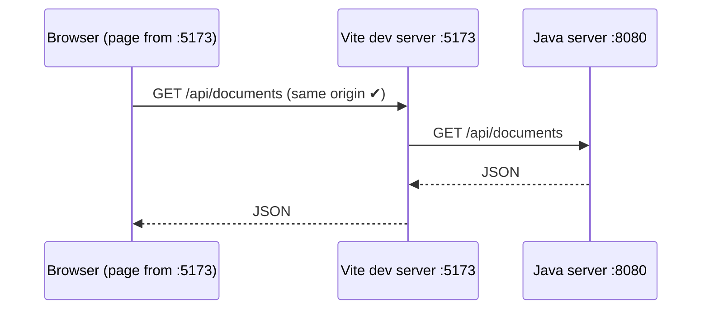
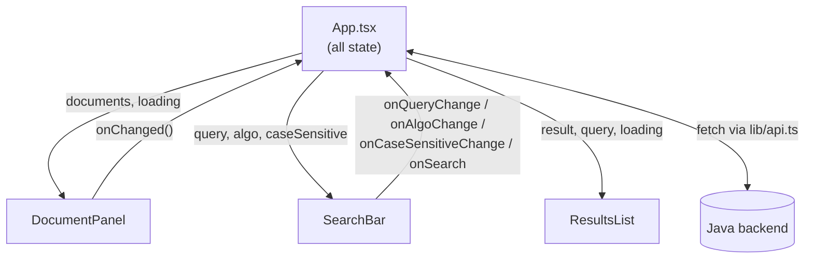
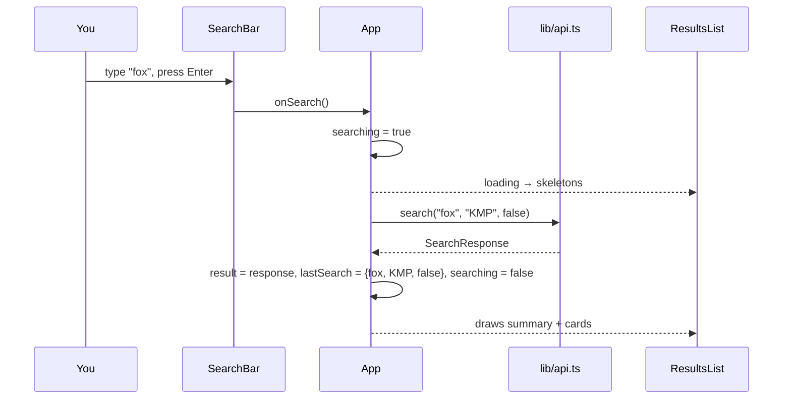
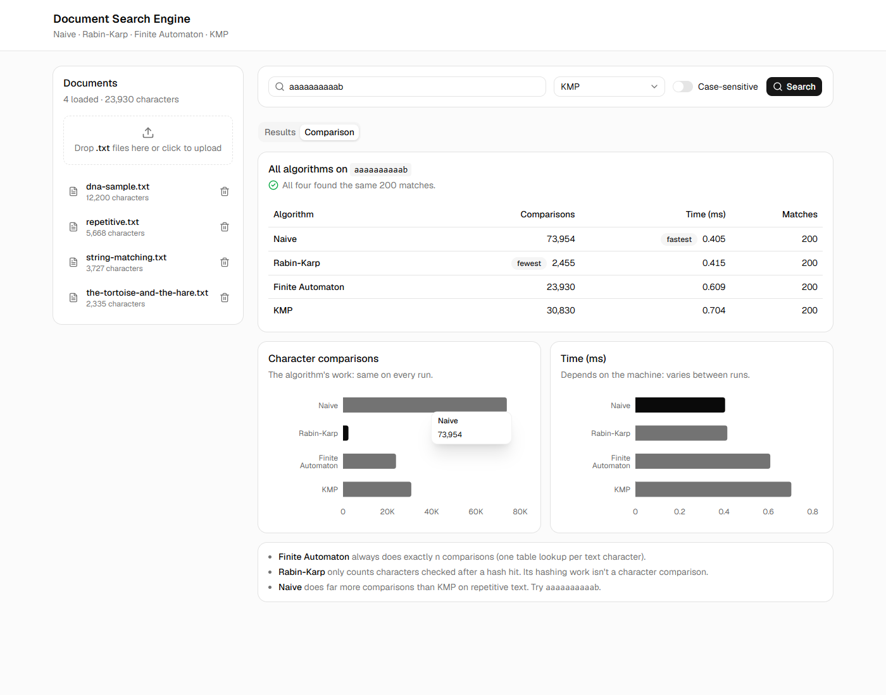
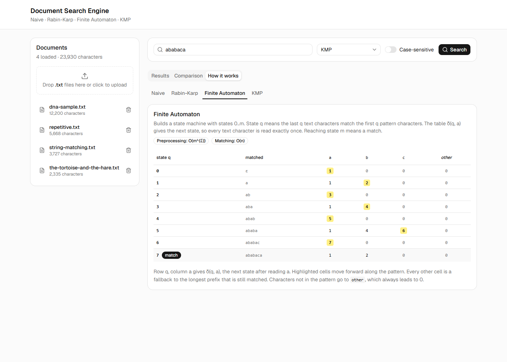
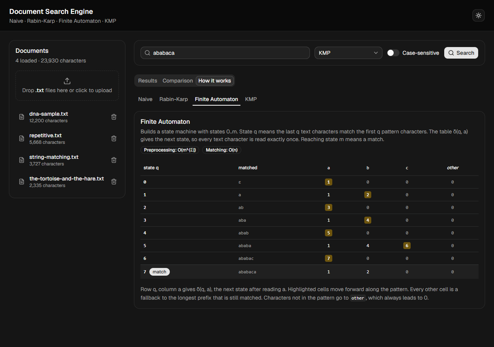
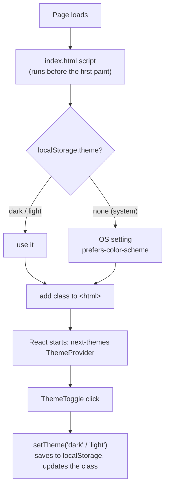
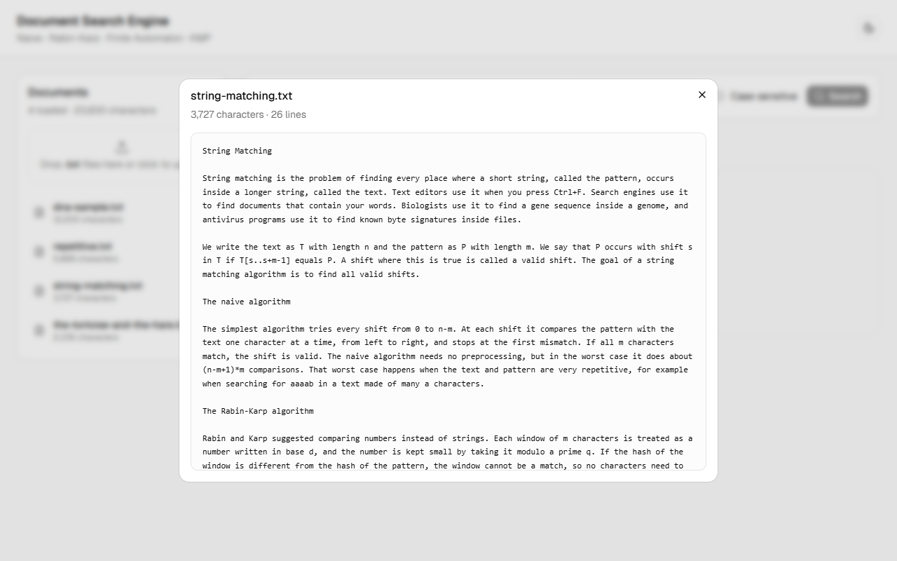
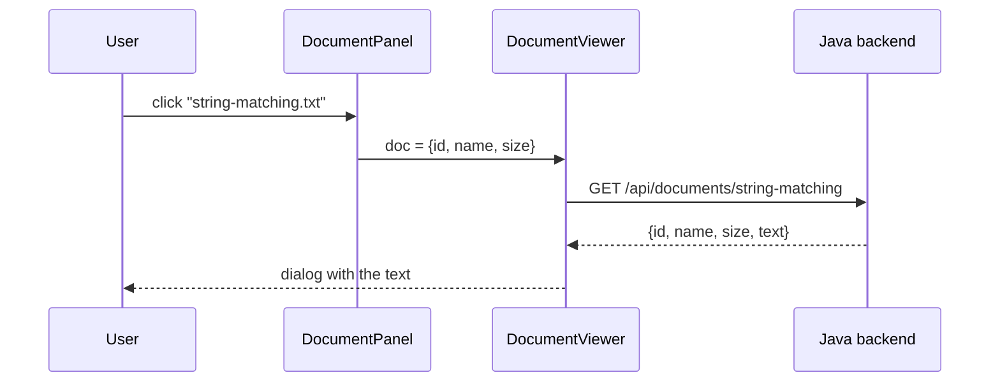

# 9. Frontend: the React UI

The frontend is a single page in React + TypeScript. It shows the documents, lets you search, and displays what the backend returns. **All the string matching happens in Java.** The browser only sends requests and draws the answers.

## 9.1 The toolchain

| Tool | What it does for us |
|---|---|
| **Vite** | Dev server with instant reload, and the production build (`npm run build`) |
| **React 19 + TypeScript** | Components with typed props and typed API data |
| **Tailwind CSS v4** | Styling with utility classes (`p-6`, `text-sm`, `border-b`...) right in the JSX |
| **shadcn/ui** | Ready-made, good-looking components (Button, Card, Tabs, Table...). Their source is copied into `src/components/ui/`, so you can open and read them |
| **Recharts** (via shadcn `chart`) | The bar chart in the Comparison tab |
| **sonner** (via shadcn `sonner`) | Small pop-up "toast" messages for errors and success |

### Project setup, step by step

```bash
npm create vite@latest frontend -- --template react-ts   # React + TypeScript template
npm install tailwindcss @tailwindcss/vite                 # Tailwind v4 as a Vite plugin
# add the "@" path alias in tsconfig.json, tsconfig.app.json and vite.config.ts
npx shadcn init -t vite -b radix -p nova                  # shadcn config + theme in src/index.css
npx shadcn add input card select switch tabs table badge scroll-area sonner chart skeleton
```

The **`@` alias** means `@/components/ui/button` points to `src/components/ui/button`. It saves writing `../../..` everywhere. It has to be set in two places: TypeScript (`paths` in the tsconfig files) so the type checker understands it, and Vite (`resolve.alias`) so the bundler does.

## 9.2 The `/api` proxy: why there's no CORS problem

The browser loads the page from `localhost:5173` (Vite), but the API runs on `localhost:8080` (Java). Browsers block a page from calling a **different origin** unless the server sends special CORS headers. Instead of adding those to Java, Vite **forwards** the calls:

```ts
// vite.config.ts
server: {
  proxy: { '/api': 'http://localhost:8080' },
},
```



From the browser's point of view, everything comes from one origin. Checked by calling the backend through Vite: `curl localhost:5173/api/documents` returns the same four documents as `curl localhost:8080/api/documents`.

## 9.3 Typed API: `lib/types.ts` and `lib/api.ts`

`lib/types.ts` describes the backend's JSON in TypeScript. It mirrors the Java records one to one:

| Java record (backend) | TypeScript interface (frontend) |
|---|---|
| `Handlers.DocumentInfo(id, name, size)` | `DocumentInfo` |
| `SearchService.SearchResponse(algorithm, timeMs, comparisons, results)` | `SearchResponse` |
| `SearchService.DocResult(docId, name, count, positions, snippets)` | `DocResult` |
| `SearchService.Snippet(before, match, after)` | `Snippet` |
| `SearchService.CompareRow(...)` | `CompareRow` |
| `SearchService.Explanation(...)` | `Explanation` (+ `Preprocessing`) |

`lib/api.ts` has one function per route (`listDocuments`, `uploadDocument`, `deleteDocument`, `search`, `compare`, `explain`). They all go through one helper:

```ts
async function request<T>(url: string, init?: RequestInit): Promise<T> {
  const res = await fetch(url, init).catch(() => null)
  if (!res?.ok) {
    const body = await res?.json().catch(() => null)
    throw new Error(body?.error ?? OFFLINE)
  }
  return (res.status === 204 ? undefined : await res.json()) as T
}
```

- If the backend answers with an error, its `{"error": "..."}` message is thrown, so the UI can show it as a toast.
- If there's **no JSON at all** (the Java server isn't running, so the proxy fails), the message says so: *"Can't reach the server. Is the backend running on port 8080?"*
- Query strings are built with `URLSearchParams`, which encodes `+` as `%2B`. So searching `Ctrl+F` really sends `Ctrl+F`, not `Ctrl F`.

## 9.4 Running it

```bash
cd backend && ./run.sh                 # terminal 1: API on :8080
cd frontend && npm install && npm run dev   # terminal 2: UI on http://localhost:5173
```

## 9.5 The page layout


```
┌──────────────────────────────────────────────────────────────────┐
│ Header: Document Search Engine                                   │
├──────────────┬───────────────────────────────────────────────────┤
│ DocumentPanel│ SearchBar: [pattern] [algorithm ▾] (case) [Search]│
│  drop-zone   ├───────────────────────────────────────────────────┤
│  doc list    │ Tabs: Results | Comparison | How it works         │
│   🗑 delete  │  ResultsList / ComparisonView / HowItWorks         │
└──────────────┴───────────────────────────────────────────────────┘
```

On narrow screens the grid becomes one column: documents first, then search, then results.

## 9.6 Where the state lives

There is no router and no state library. All the state is plain `useState` in `App.tsx`, and it's passed down to the components as **props**. Components report changes back up through **callback props** (`onSearch`, `onChanged`...).

| State in `App.tsx` | Meaning | Used by |
|---|---|---|
| `documents`, `loadingDocs` | The document list from `GET /api/documents` | DocumentPanel |
| `query`, `algo`, `caseSensitive` | What's typed and selected in the search bar right now | SearchBar |
| `lastSearch` | The pattern/algorithm/case setting of the results on screen | ResultsList, re-searching |
| `result`, `searching` | The last `SearchResponse`, and whether a search is running | ResultsList |



**Why keep `lastSearch` separate from `query`?** If you search `fox` and then start typing `foxes`, the results on screen are still for `fox`. The summary line must say `fox`, so it reads from `lastSearch`, not from the input box.

### What happens on Search



### After an upload or delete

`DocumentPanel` calls the API itself, shows a toast, then calls `onChanged()`. `App` then reloads the document list **and re-runs the last search**, so the results never show a document that was just deleted (or miss one that was just uploaded).

## 9.7 The components

### DocumentPanel

- **Drop-zone:** a dashed box that handles `onDragOver` / `onDrop`. Clicking it opens a hidden `<input type="file" accept=".txt" multiple>`. Each file is read in the browser with `file.text()` and sent as the body of `POST /api/documents?name=...`.
- Files that don't end in `.txt` are rejected with a toast before anything is sent.
- After picking, the input's value is reset to `""`. Otherwise the browser wouldn't fire `onChange` if you picked the same file again.
- The list shows each name and character count, plus a delete button (🗑). Clicking a name opens the document in a viewer (9.12).
- While loading: three grey **skeleton** bars. With no documents: a short hint.
- The list scrolls once it's taller than 24rem (`ScrollArea`).

### SearchBar

- A `<form>`, so pressing **Enter** searches, the same as clicking the button.
- The input has `maxLength={100}`, the same limit as the backend (`MAX_PATTERN_LENGTH`).
- The algorithm `Select` lists the four algorithms from `ALGORITHMS` in `types.ts`. KMP is the default.
- The **Search** button is disabled while the pattern is empty or a search is running, and shows a spinner while running.

### ResultsList

| Situation | What you see |
|---|---|
| no search yet | an empty state explaining what to do |
| searching | skeleton bars |
| no matches | "No matches: "zzzz" doesn't occur in any document." |
| matches | summary line + one card per document |

The **summary line** shows the total matches and the badges *algorithm · time · comparisons*. For example: **7 matches for `fox` in 1 document** · KMP · 1.179 ms · 24,036 comparisons.

Each **document card** shows:
- the match count (badge),
- the positions, i.e. the valid shifts s (up to 30, then "+N more"),
- one line per snippet: the position, then `before` **`match`** `after`, with the match in a yellow `<mark>`. Snippets use a monospace font, so DNA sequences line up.

Because snippets come from the original text, a case-insensitive search for `fox` shows both `fox` and `Fox` highlighted. Switching on **Case-sensitive** and searching `Fox` with Rabin-Karp finds only the 3 capitalised ones.

## 9.8 How it was checked

A Playwright script drove the real app in Microsoft Edge (kept outside the repo, since the project has no test framework):

| Action | Result |
|---|---|
| open the page | 4 sample documents listed, 23,930 characters |
| search `fox`, KMP, case-insensitive | 7 matches in `the-tortoise-and-the-hare.txt`, 24,036 comparisons |
| Rabin-Karp + case-sensitive, `Fox` | "3 matches for Fox in 1 document" |
| search `zzzz` | "No matches" empty state |
| upload a 40-character `.txt` while `FOX` is searched | toast, list shows 5 docs, results re-run and include the new file |
| delete it | toast, back to 4 docs |
| backend stopped | toast: "Can't reach the server. Is the backend running on port 8080?" |
| 420px-wide window | single-column layout |

No errors appeared in the browser console.

One React detail: in development, `<StrictMode>` runs every effect **twice** to help find bugs. So the "load documents" effect fired twice and showed the offline toast twice. Passing `{ id: e.message }` to `toast.error` fixed it, because sonner shows only one toast per id.

## 9.9 The Comparison tab



Pressing **Search** now sends **two requests at the same time**, the chosen algorithm's search and the comparison of all four:

```ts
const [found, compared] = await Promise.all([
  api.search(params.q, params.algo, params.caseSensitive),
  api.compare(params.q, params.caseSensitive),
])
```

`Promise.all` waits for both. So switching between the *Results* and *Comparison* tabs is instant, and both tabs always describe the **same** search.

### What `ComparisonView` shows

1. **A check line:** *"All four found the same 200 matches."* If the algorithms ever disagreed, it would show a warning instead. That would mean a bug in one of them.
2. **A table:** comparisons, time and matches per algorithm. A **fewest** badge marks the lowest comparison count, and a **fastest** badge the lowest time.
3. **Two bar charts:** one for comparisons, one for time.
4. **Three notes** explaining the numbers that surprise people most (FA = n, how Rabin-Karp is counted, Naive on repetitive text).

### Chart design choices

| Choice | Why |
|---|---|
| **Two charts, not one with two y-axes** | Comparisons (tens of thousands) and milliseconds (around 1) have completely different scales. A chart with two y-axes makes you compare bar heights that mean different things. |
| **Horizontal bars** | Algorithm names like "Finite Automaton" fit on the left instead of being squeezed under the bars. |
| **One colour, best bar dark** | Each chart shows a single measure, so colour isn't needed to tell series apart. Instead it **emphasises** the winner: the lowest bar is dark, the rest grey. |
| **Thin bars (max 24px), rounded only at the end** | The bar grows from a flat baseline. The rounded end is where the value is. |
| **Tooltip on hover** | Shows the exact value. The table lists every number anyway. |
| **Compact axis ticks** | `80000` is shown as `80K`. |

### Real numbers (from the app, pattern `aaaaaaaaaab`)

| Algorithm | Comparisons | Matches |
|---|---|---|
| Naive | 73,954 | 200 |
| Rabin-Karp | **2,455** (fewest) | 200 |
| Finite Automaton | 23,930 | 200 |
| KMP | 30,830 | 200 |

The comparison counts are identical every time you run it. The times changed on every run during testing; for example, KMP took 0.453 ms on one run and 0.704 ms on another. That's why the time chart says *"Depends on the machine: varies between runs."*

### Small screens

At 420px wide the table was too wide. Two things are hidden below the `sm` breakpoint (640px):
- the **Matches** column: the check line above the table already says how many matches all four found,
- the **fewest / fastest** badges: the dark bar in each chart still shows the winner.

Tailwind does this with classes like `hidden sm:table-cell` (hidden by default, a normal table cell from `sm` up).

## 9.10 The How it works tab



This tab shows, for the pattern you just searched, the description and complexity of each algorithm and **the table it builds before reading the text**. It's the "preprocessing" from the algorithm pages, computed live by the backend's `/api/explain`.

### One search, all four explanations

`runSearch` now asks for everything at once. That includes the explanation of **all four** algorithms, so switching between them inside the tab needs no new request:

```ts
const P = params.caseSensitive ? params.q : params.q.toLowerCase()
const [found, compared, explained] = await Promise.all([
  api.search(params.q, params.algo, params.caseSensitive),
  api.compare(params.q, params.caseSensitive),
  Promise.all(ALGORITHMS.map((a) => api.explain(P, a.value))),
])
```

**Why lowercase `P`?** A case-insensitive search lowercases the pattern before matching. The tables must show the pattern the matchers **really** use. Searching `The Fox` case-insensitively gives a KMP row `t h e ␣ f o x`, not `T h e ␣ F o x`.

The inner tabs (Naive · Rabin-Karp · Finite Automaton · KMP) open on **the algorithm you searched with**. `HowItWorks` gets a `key` built from the last search, so a new search re-creates it, and it opens on the new search's algorithm again.

### What each algorithm shows (pattern `ababaca`)

**Naive:** no table. It doesn't preprocess.

**Rabin-Karp:** four numbers:

| | Value | Meaning |
|---|---|---|
| d | 256 | radix (alphabet size) |
| q | 101 | prime modulus |
| h | 25 | d<sup>m−1</sup> mod q = 256<sup>6</sup> mod 101 |
| p | 51 | hash of the pattern |

plus the rolling-hash formula `t′ = (d·(t − T[s]·h) + T[s+m]) mod q`.

**Finite Automaton:** the δ table. One row per state q = 0..7, one column per pattern character plus **other**:

| state q | matched | a | b | c | other |
|---|---|---|---|---|---|
| 0 | ε | **1** | 0 | 0 | 0 |
| 1 | a | 1 | **2** | 0 | 0 |
| 2 | ab | **3** | 0 | 0 | 0 |
| 3 | aba | 1 | **4** | 0 | 0 |
| 4 | abab | **5** | 0 | 0 | 0 |
| 5 | ababa | 1 | 4 | **6** | 0 |
| 6 | ababac | **7** | 0 | 0 | 0 |
| 7 ✔ | ababaca | 1 | 2 | 0 | 0 |

This is CLRS Figure 32.7. How the UI makes it readable:
- **Highlighted (bold) cells** are the forward transitions δ(q, P[q]) = q + 1, the path straight along the pattern. In the code, a cell is highlighted when `next === q + 1`.
- Every **other** cell is a fallback. For example δ(5, b) = 4: after `ababa` then `b`, the longest prefix of the pattern that is still matched is `abab`.
- The **matched** column shows which prefix state q stands for (ε means the empty string).
- The last row (q = m) is marked **match**.
- Spaces are shown as `␣`, so a pattern like `the fox` has a visible column for the space.

**KMP:** the prefix function under the pattern:

| q | 0 | 1 | 2 | 3 | 4 | 5 | 6 |
|---|---|---|---|---|---|---|---|
| P[q] | a | b | a | b | a | c | a |
| π[q] | 0 | 0 | **1** | **2** | **3** | 0 | **1** |

Non-zero π values are bold. Those are the places where KMP can keep part of a match after a mismatch instead of starting over.

### Final polish

- **Complexity badges** now use real symbols: `O(m³·|Σ|)` and `O((n−m+1)·m)` instead of `m^3` and `n-m+1`. The strings live in the backend's `Algorithm.java`, which `run.sh` / `run.ps1` compile with `-encoding UTF-8`.
- In the Rabin-Karp view, `h` uses real superscripts (`<sup>`), and the rolling-hash formula is on its own line instead of wrapping in the middle.
- **Favicon:** the Vite logo was replaced with a small magnifier icon (`public/favicon.svg`).
- **Re-checked in Edge:** all of the 9.8 checks plus the Comparison and How-it-works tabs, on desktop and at 420px. No console errors.

## 9.11 Dark mode

A sun/moon button in the header switches between light and dark. The first time you open the app it follows your OS setting. After you click the button, your choice is saved and used on the next visit.



### How CSS variables make it cheap

shadcn/ui never writes a fixed colour like `bg-white`. Components use **semantic names** (`bg-background`, `text-muted-foreground`, `border-border`), and each name points to a CSS variable. `index.css` defines every variable twice:

```css
:root { --background: oklch(1 0 0);     --foreground: oklch(0.145 0 0); }   /* light */
.dark { --background: oklch(0.145 0 0); --foreground: oklch(0.985 0 0); }   /* dark  */
```

So dark mode is just **one class on `<html>`**. When `dark` is there, every variable switches, and every component changes colour with no extra code.

| Name used in a component | Light | Dark |
|---|---|---|
| `background` | white | near-black |
| `foreground` | near-black | near-white |
| `muted` (tiles, code chips) | light grey | dark grey |
| `border` | light grey | white at 10% |

The only places that needed changes were the three fixed colours: the yellow highlight in the δ table, the green tick in the Comparison tab, and the match `<mark>` (which already had one). Each got a `dark:` variant, for example `bg-yellow-200 dark:bg-yellow-500/40`. The bar charts already used `var(--foreground)` for the best bar, so in dark mode it turns white.

### Who sets the class



- **`next-themes`** (already installed, because shadcn's toast component reads the theme from it) wraps the app in `main.tsx`. It keeps the class in sync, saves the choice, and gives `ThemeToggle` the `useTheme()` hook.
- **The `index.html` script** prevents a white flash. Without it, React has to load before the class is set, so a dark-mode user would see one frame of the light page. next-themes has its own script for this, but that script only runs when the page is rendered on a server. Here it never runs, and React 19 prints a warning about it, so `main.tsx` marks it as data (`scriptProps={{ type: "application/json" }}`) and `index.html` does the job instead.
- **`ThemeToggle`** draws both icons and lets CSS pick one (`dark:hidden` / `hidden dark:block`), so the icon is correct from the first frame.

### How it was checked

In Edge, with the same throwaway Playwright setup as 9.8:

| Check | Result |
|---|---|
| Fresh visit, OS in light mode | `<html class="light">` |
| Fresh visit, OS in dark mode | `<html class="dark">` |
| Click the toggle | class becomes `dark`, `localStorage.theme = "dark"` |
| Reload the page | stays `dark` |
| Click again | back to `light` |
| Results, Comparison and How it works tabs in dark mode | readable, highlights visible |
| Console errors | none |


## 9.12 Viewing a document

Clicking a document in the list opens its full text in a shadcn `Dialog`.





- **Why a separate route?** `GET /api/documents` only sends `{id,name,size}`, so the list stays small no matter how big the files are. The text is fetched only when you open a document.
- **State:** `DocumentPanel` keeps `viewing` (the open document, or `null`). The dialog is open whenever `viewing` is not `null`, and closing it (✕, Esc, or clicking outside) sets it back to `null`.
- **Loading:** `DocumentViewer` remembers which document its text belongs to. If you open a different one, the old text is not shown: skeleton bars appear until the new text arrives.
- **Layout:** the text is in a `<pre>` with `whitespace-pre-wrap`, so line breaks are kept but long lines wrap. The box scrolls once it is taller than 60% of the screen. The header shows the size and line count, e.g. `3,727 characters · 26 lines` for `string-matching.txt`.
- **Keyboard:** each row is a real `<button>`, so Tab + Enter opens it. The delete button is a separate button next to it.

### How it was checked

In Edge, with a throwaway Playwright script:

| Check | Result |
|---|---|
| Open `string-matching.txt` | title and `3,727 characters · 26 lines`, 3,727 characters of text shown |
| Close with Esc, open `repetitive.txt` | shows the new text (`aaaa...`), not the old one |
| Close with ✕, focus `dna-sample.txt`, press Enter | opens |
| 420px wide screen, dark mode | fits and is readable |
| Console errors | none |
