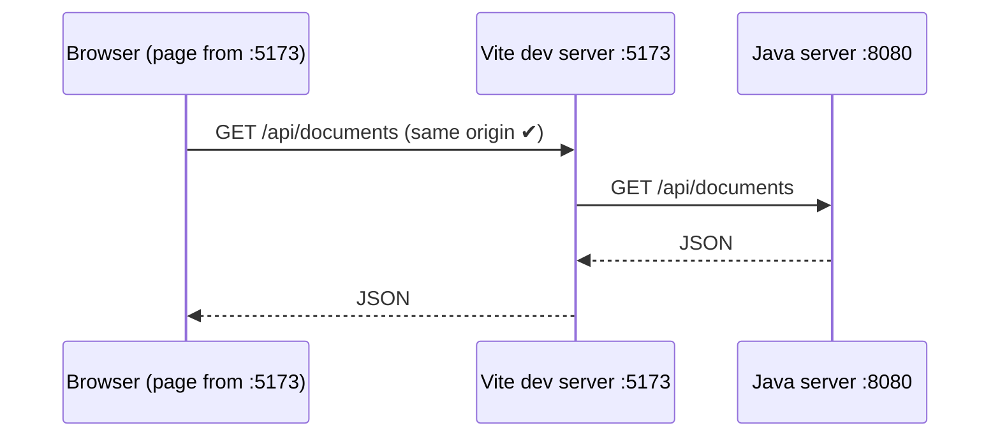
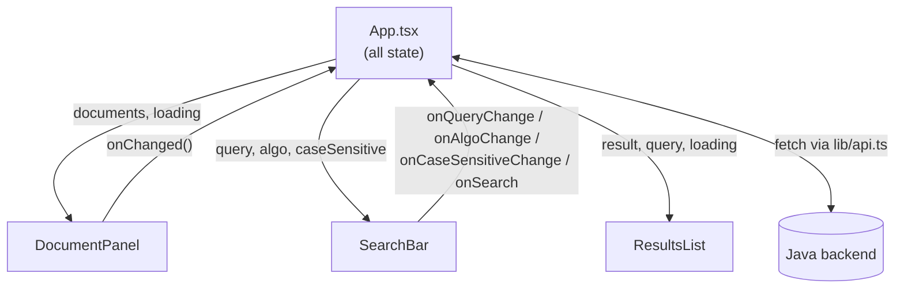
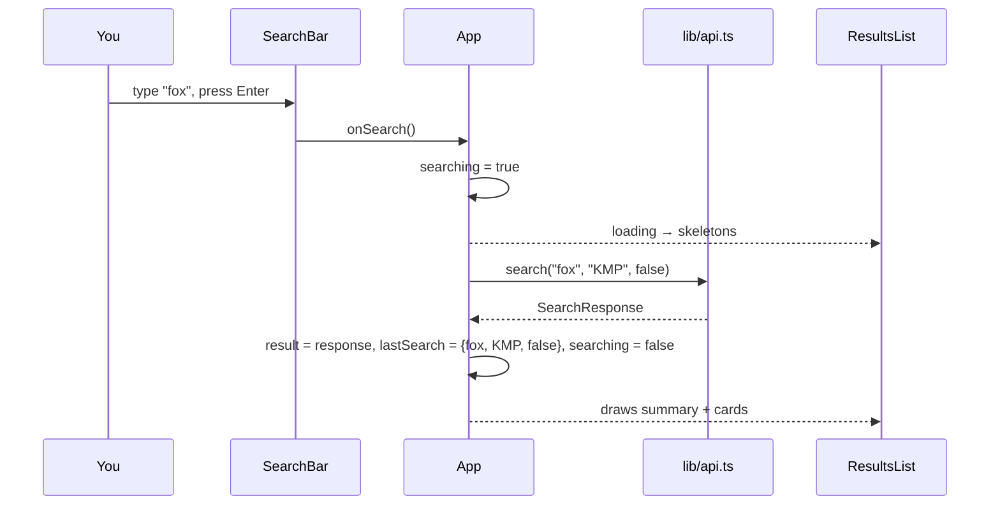

# 9. Frontend: the React UI

The frontend is a single page in React + TypeScript. It shows the documents, lets you search, and displays what the backend returns. **All the string matching happens in Java.** The browser only sends requests and draws the answers.

## 9.1 The toolchain

| Tool | What it does for us |
|---|---|
| **Vite** | Dev server with instant reload, and the production build (`npm run build`) |
| **React 19 + TypeScript** | Components with typed props and typed API data |
| **Tailwind CSS v4** | Styling with utility classes (`p-6`, `text-sm`, `border-b`...) right in the JSX |
| **shadcn/ui** | Ready-made, good-looking components (Button, Card, Tabs, Table...). Their source is copied into `src/components/ui/`, so you can open and read them |
| **Recharts** (via shadcn `chart`) | The bar chart in the Comparison tab |
| **sonner** (via shadcn `sonner`) | Small pop-up "toast" messages for errors and success |

### Project setup, step by step

```bash
npm create vite@latest frontend -- --template react-ts   # React + TypeScript template
npm install tailwindcss @tailwindcss/vite                 # Tailwind v4 as a Vite plugin
# add the "@" path alias in tsconfig.json, tsconfig.app.json and vite.config.ts
npx shadcn init -t vite -b radix -p nova                  # shadcn config + theme in src/index.css
npx shadcn add input card select switch tabs table badge scroll-area sonner chart skeleton
```

The **`@` alias** means `@/components/ui/button` points to `src/components/ui/button`. It saves writing `../../..` everywhere. It has to be set in two places: TypeScript (`paths` in the tsconfig files) so the type checker understands it, and Vite (`resolve.alias`) so the bundler does.

## 9.2 The `/api` proxy: why there's no CORS problem

The browser loads the page from `localhost:5173` (Vite), but the API runs on `localhost:8080` (Java). Browsers block a page from calling a **different origin** unless the server sends special CORS headers. Instead of adding those to Java, Vite **forwards** the calls:

```ts
// vite.config.ts
server: {
  proxy: { '/api': 'http://localhost:8080' },
},
```



From the browser's point of view, everything comes from one origin. Checked by calling the backend through Vite: `curl localhost:5173/api/documents` returns the same four documents as `curl localhost:8080/api/documents`.

## 9.3 Typed API: `lib/types.ts` and `lib/api.ts`

`lib/types.ts` describes the backend's JSON in TypeScript. It mirrors the Java records one to one:

| Java record (backend) | TypeScript interface (frontend) |
|---|---|
| `Handlers.DocumentInfo(id, name, size)` | `DocumentInfo` |
| `SearchService.SearchResponse(algorithm, timeMs, comparisons, results)` | `SearchResponse` |
| `SearchService.DocResult(docId, name, count, positions, snippets)` | `DocResult` |
| `SearchService.Snippet(before, match, after)` | `Snippet` |
| `SearchService.CompareRow(...)` | `CompareRow` |
| `SearchService.Explanation(...)` | `Explanation` (+ `Preprocessing`) |

`lib/api.ts` has one function per route (`listDocuments`, `uploadDocument`, `deleteDocument`, `search`, `compare`, `explain`). They all go through one helper:

```ts
async function request<T>(url: string, init?: RequestInit): Promise<T> {
  const res = await fetch(url, init).catch(() => null)
  if (!res?.ok) {
    const body = await res?.json().catch(() => null)
    throw new Error(body?.error ?? OFFLINE)
  }
  return (res.status === 204 ? undefined : await res.json()) as T
}
```

- If the backend answers with an error, its `{"error": "..."}` message is thrown, so the UI can show it as a toast.
- If there's **no JSON at all** (the Java server isn't running, so the proxy fails), the message says so: *"Can't reach the server. Is the backend running on port 8080?"*
- Query strings are built with `URLSearchParams`, which encodes `+` as `%2B`. So searching `Ctrl+F` really sends `Ctrl+F`, not `Ctrl F`.

## 9.4 Running it

```bash
cd backend && ./run.sh                 # terminal 1: API on :8080
cd frontend && npm install && npm run dev   # terminal 2: UI on http://localhost:5173
```

## 9.5 The page layout


```
┌──────────────────────────────────────────────────────────────────┐
│ Header: Document Search Engine                                   │
├──────────────┬───────────────────────────────────────────────────┤
│ DocumentPanel│ SearchBar: [pattern] [algorithm ▾] (case) [Search]│
│  drop-zone   ├───────────────────────────────────────────────────┤
│  doc list    │ Tabs: Results                                     │
│   🗑 delete  │  ResultsList: summary + one card per document      │
└──────────────┴───────────────────────────────────────────────────┘
```

On narrow screens the grid becomes one column: documents first, then search, then results.

## 9.6 Where the state lives

There is no router and no state library. All the state is plain `useState` in `App.tsx`, and it's passed down to the components as **props**. Components report changes back up through **callback props** (`onSearch`, `onChanged`...).

| State in `App.tsx` | Meaning | Used by |
|---|---|---|
| `documents`, `loadingDocs` | The document list from `GET /api/documents` | DocumentPanel |
| `query`, `algo`, `caseSensitive` | What's typed and selected in the search bar right now | SearchBar |
| `lastSearch` | The pattern/algorithm/case setting of the results on screen | ResultsList, re-searching |
| `result`, `searching` | The last `SearchResponse`, and whether a search is running | ResultsList |



**Why keep `lastSearch` separate from `query`?** If you search `fox` and then start typing `foxes`, the results on screen are still for `fox`. The summary line must say `fox`, so it reads from `lastSearch`, not from the input box.

### What happens on Search



### After an upload or delete

`DocumentPanel` calls the API itself, shows a toast, then calls `onChanged()`. `App` then reloads the document list **and re-runs the last search**, so the results never show a document that was just deleted (or miss one that was just uploaded).

## 9.7 The components

### DocumentPanel

- **Drop-zone:** a dashed box that handles `onDragOver` / `onDrop`. Clicking it opens a hidden `<input type="file" accept=".txt" multiple>`. Each file is read in the browser with `file.text()` and sent as the body of `POST /api/documents?name=...`.
- Files that don't end in `.txt` are rejected with a toast before anything is sent.
- After picking, the input's value is reset to `""`. Otherwise the browser wouldn't fire `onChange` if you picked the same file again.
- The list shows each name and character count, plus a delete button (🗑).
- While loading: three grey **skeleton** bars. With no documents: a short hint.
- The list scrolls once it's taller than 24rem (`ScrollArea`).

### SearchBar

- A `<form>`, so pressing **Enter** searches, the same as clicking the button.
- The input has `maxLength={100}`, the same limit as the backend (`MAX_PATTERN_LENGTH`).
- The algorithm `Select` lists the four algorithms from `ALGORITHMS` in `types.ts`. KMP is the default.
- The **Search** button is disabled while the pattern is empty or a search is running, and shows a spinner while running.

### ResultsList

| Situation | What you see |
|---|---|
| no search yet | an empty state explaining what to do |
| searching | skeleton bars |
| no matches | "No matches: "zzzz" doesn't occur in any document." |
| matches | summary line + one card per document |

The **summary line** shows the total matches and the badges *algorithm · time · comparisons*. For example: **7 matches for `fox` in 1 document** · KMP · 1.179 ms · 24,036 comparisons.

Each **document card** shows:
- the match count (badge),
- the positions, i.e. the valid shifts s (up to 30, then "+N more"),
- one line per snippet: the position, then `before` **`match`** `after`, with the match in a yellow `<mark>`. Snippets use a monospace font, so DNA sequences line up.

Because snippets come from the original text, a case-insensitive search for `fox` shows both `fox` and `Fox` highlighted. Switching on **Case-sensitive** and searching `Fox` with Rabin-Karp finds only the 3 capitalised ones.

## 9.8 How it was checked

A Playwright script drove the real app in Microsoft Edge (kept outside the repo, since the project has no test framework):

| Action | Result |
|---|---|
| open the page | 4 sample documents listed, 23,930 characters |
| search `fox`, KMP, case-insensitive | 7 matches in `the-tortoise-and-the-hare.txt`, 24,036 comparisons |
| Rabin-Karp + case-sensitive, `Fox` | "3 matches for Fox in 1 document" |
| search `zzzz` | "No matches" empty state |
| upload a 40-character `.txt` while `FOX` is searched | toast, list shows 5 docs, results re-run and include the new file |
| delete it | toast, back to 4 docs |
| backend stopped | toast: "Can't reach the server. Is the backend running on port 8080?" |
| 420px-wide window | single-column layout |

No errors appeared in the browser console.

One React detail: in development, `<StrictMode>` runs every effect **twice** to help find bugs. So the "load documents" effect fired twice and showed the offline toast twice. Passing `{ id: e.message }` to `toast.error` fixed it, because sonner shows only one toast per id.
