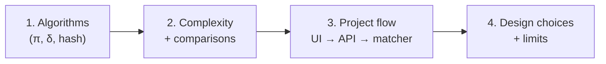
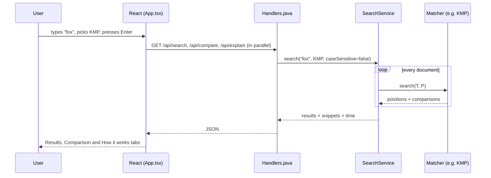

# 10. Viva Guide

This page lists **what to focus on** for the viva and gives **answers in simple language** to the questions you are most likely to be asked. Every number here comes from running the project's code.

> **Golden rule:** examiners care most about the **algorithms**, then about **how you measured them**, and only a little about the UI. Spend your time in that order.

## What to focus on (priority list)

| Priority | Area | Why it matters | Where to revise |
|---|---|---|---|
| 🔴 Must know | KMP: prefix function π, why the text pointer never goes back, why O(n) | Most asked string matching question | [06-kmp](06-kmp.md), Part E below |
| 🔴 Must know | Rabin-Karp: rolling hash, spurious hits, role of q and d | Second most asked | [04-rabin-karp](04-rabin-karp.md), Part C |
| 🔴 Must know | Finite Automaton: δ table, states, why O(m³·\|Σ\|) preprocessing | Builds the idea behind KMP | [05-finite-automaton](05-finite-automaton.md), Part D |
| 🔴 Must know | Complexity of all four (preprocessing + matching) | Asked in almost every viva | Part F |
| 🟠 Should know | Naive: worst case input and its cost | Easy marks | [03-naive](03-naive.md), Part B |
| 🟠 Should know | How you counted comparisons and why time in ms is not reliable | Shows your comparison is fair | Part F |
| 🟠 Should know | Flow of one search from the UI to the matcher and back | "Explain your project" question | Part G |
| 🟢 Good to know | Why plain Java, why no libraries, why a React UI | Design choice questions | Part G, H |
| 🟢 Good to know | Limits and how you would scale it | Shows maturity | Part I |



## Practice examples to know by heart

**Example 1 (the CLRS one, used everywhere in these docs):**

```
T = abababacaba   (n = 11)
P = ababaca       (m = 7)      one match at s = 2
π = [0, 0, 1, 2, 3, 0, 1]
```

| Naive | Rabin-Karp | Finite Automaton | KMP |
|---|---|---|---|
| 19 | 7 | 11 | 12 |

**Example 2 (a fresh one, good for practising on paper):**

```
T = abcxabcdabcabd   (n = 14)
P = abcabd           (m = 6)      one match at s = 8
π = [0, 0, 0, 1, 2, 0]
```

| Naive | Rabin-Karp | Finite Automaton | KMP |
|---|---|---|---|
| 20 | 6 | 14 | 16 |

If the examiner gives you a pattern, compute π for it on paper using the method in Part E. That is the single most common "do it on the board" task.

---

## Part A: Basics

**Q1. What is the string matching problem?**
We have a long text T of length n and a short pattern P of length m. We want **every position** in T where P appears. Each such position is called a **valid shift** s, meaning `T[s .. s+m-1] = P`. Our project returns all valid shifts, 0-based.

**Q2. Why did you implement four algorithms instead of one?**
Because the project is about **comparing** techniques. Each algorithm improves on the Naive one in a different way:
- Rabin-Karp skips most windows using a cheap number (hash) check.
- Finite Automaton remembers how much of the pattern has matched, using a table.
- KMP stores the same memory in a much smaller array π.

Showing all four side by side makes the trade-offs visible.

**Q3. What is "preprocessing"?**
Work done on the **pattern only**, before looking at the text. Naive does none. Rabin-Karp computes the pattern hash. FA builds the δ table. KMP builds the π array. Preprocessing is paid once per search; matching is paid for every document.

**Q4. What do you mean by "character comparisons"?**
The number of times the algorithm checks one text character against one pattern character. We count it inside each matcher. It measures the **algorithm's work** without being affected by the computer's speed. For FA, one table lookup per text character counts as one comparison.

---

## Part B: Naive

**Q5. How does Naive work?**
Place the pattern at shift 0, compare character by character, stop at the first mismatch. Then move the pattern one step right and repeat, up to shift n − m.

**Q6. What is its complexity and what is the worst case input?**
O((n − m + 1) · m). The worst case is when almost every shift matches for a long time before failing, for example `T = aaaa...ab` and `P = aaaab`. Every shift compares nearly all m characters.

Real numbers: `T = aaaaaaaaaaaaaaaaaaab` (n = 20), `P = aaaab` (m = 5) → Naive does **80** comparisons. KMP does 35, FA does 20.

**Q7. Is Naive always the slowest?**
No. On normal English text the first character usually fails right away, so Naive does about one comparison per shift. On our sample documents, searching `the` gives Naive 27,615 and KMP 27,309, nearly equal. For `hello world` / `xyz`, Naive does **9** and KMP does **11**. Naive only loses badly when there are many partial matches (`aaaaaaaaaab` on our samples: Naive 73,954 vs KMP 30,830).

---

## Part C: Rabin-Karp

**Q8. Explain the idea of Rabin-Karp.**
Turn every m-character window of the text into a **number** (its hash). Compute the pattern's hash once. Slide over the text: if a window's hash differs from the pattern's hash, it **cannot** match, so skip it without comparing characters. Only when hashes are equal do we check the characters.

**Q9. How is the hash computed?**
Treat the string like a number in base d. For `P = p₀p₁...pₘ₋₁`:
```
hash = (p₀·d^(m-1) + p₁·d^(m-2) + ... + pₘ₋₁) mod q
```
We compute it with Horner's rule: `value = (d * value + next char) mod q`. In our code `d = 256` and `q = 101`.

**Q10. What is the rolling hash and why is it needed?**
Computing every window's hash from scratch would cost O(m) per window, which is no better than Naive. The rolling hash updates the hash in **O(1)** when the window moves one step: remove the leftmost character, shift, add the new character.
```
t(s+1) = ( d · ( t(s) − T[s]·h ) + T[s+m] ) mod q,      where h = d^(m-1) mod q
```
`h` is the "weight" of the leftmost character, computed once in preprocessing. For `ababaca`, `h = 25` and the pattern hash `p = 51`.

**Q11. What is a spurious hit?**
When a window has the **same hash** as the pattern but **different characters**. It happens because many different numbers leave the same remainder mod q. Example from our samples: the window `aca` has hash **41**, the same as `fox`. Searching `fox` on the sample documents gave **241** hash hits, of which only **7** were real matches and **234** were spurious.

**Q12. Can Rabin-Karp give a wrong answer because of spurious hits?**
No. On every hash hit we **verify** the characters. Spurious hits only cost extra comparisons, never wrong results.

**Q13. Why should q be a prime? Why did you pick 101?**
A prime spreads the remainders evenly, so collisions are rarer. The expected number of spurious hits is about (number of windows) / q. For `fox` that is 23,922 / 101 ≈ 237, and we measured 234, which matches the theory well. We chose a **small** q (101) so the hash values are easy to show and explain in the UI. A real system would use a large prime (like 10⁹ + 7) to get almost no spurious hits.

**Q14. Why d = 256?**
d is the size of the alphabet. 256 covers all ASCII and extended ASCII codes, so each character is one "digit" in base 256. (Java characters can go above 255, but that only makes the hash slightly weaker. It is still correct because we always verify.)

**Q15. Complexity?**
Preprocessing O(m). Matching average O(n + m). Worst case O((n − m + 1) · m), when every window is a hit, for example `T = aaaa...a`, `P = aa...a`.

**Q16. Why does Rabin-Karp show the fewest comparisons in your app?**
Because we only count character checks done to **verify hits**. Hash arithmetic is not a character comparison. That is fair to the definition but makes Rabin-Karp look very cheap. In milliseconds it is not always the fastest, because it does modular arithmetic for every window.

---

## Part D: Finite Automaton

**Q17. Explain the finite automaton matcher.**
We build a machine with states 0 to m. Being in **state q means the last q characters read match the first q characters of P**. For each state and each character, a table δ(q, a) tells the next state. We read the text one character at a time and follow the table. Reaching state m means a match ends here.

**Q18. How is δ(q, a) computed?**
δ(q, a) = the **largest k** such that the first k characters of P are a **suffix** of (the first q characters of P followed by a). In plain words: "after reading a, how much of the pattern is still matched at the end?"

Example for `P = ababaca`: in state 5 (`ababa` matched), reading `b` gives `ababab`. The longest prefix of P that ends this string is `abab`, so δ(5, b) = 4. Reading `c` gives `ababac`, so δ(5, c) = 6.

**Q19. Why is preprocessing O(m³ · |Σ|)?**
Count the loops in `computeTransitionFunction`:
- (m + 1) states × |Σ| characters = the number of table cells,
- for each cell, k is tried from up to m + 1 down to 0 (up to m tries),
- each try checks a suffix of up to m characters.

m × |Σ| × m × m = O(m³ · |Σ|). (CLRS shows it can be reduced to O(m · |Σ|) using π, but the simple version is easier to explain.)

**Q20. Why is matching O(n)?**
Each text character is read **exactly once** and causes exactly one table lookup. No going back. That is why our FA comparison count is always exactly **n**: 23,930 on the sample documents, for every pattern.

**Q21. Your alphabet is only the pattern's characters. Is that correct?**
Yes. We use the distinct characters of P plus one **"other"** column. Any character not in P cannot continue a match, so from every state it leads to state 0. This gives the same answers as a full 256-column table but stays small enough to show on screen.

**Q22. Why limit the pattern to 100 characters?**
Because of the O(m³ · |Σ|) preprocessing. A 100-character pattern already means around 10⁶ × |Σ| steps. The limit keeps the server responsive.

---

## Part E: KMP (most important)

**Q23. What is the main idea of KMP?**
When a mismatch happens after matching q characters, we **already know** those q text characters: they equal `P[0..q-1]`. So we don't need to move the text pointer back. We only ask: "what is the longest part of what I matched that could still be the start of a match?" The π array answers this in O(1).

**Q24. Define the prefix function π.**
`π[q]` = the length of the longest **proper prefix** of `P[0..q]` that is also a **suffix** of `P[0..q]`. "Proper" means not the whole string.

**Q25. Compute π for `ababaca` step by step.** (Practise this on paper.)

| q | P[0..q] | longest proper prefix that is also a suffix | π[q] |
|---|---|---|---|
| 0 | `a` | (none) | 0 |
| 1 | `ab` | (none) | 0 |
| 2 | `aba` | `a` | 1 |
| 3 | `abab` | `ab` | 2 |
| 4 | `ababa` | `aba` | 3 |
| 5 | `ababac` | (none, nothing ends in `c` except the whole string) | 0 |
| 6 | `ababaca` | `a` | 1 |

How the code gets π[5]: k was 3. `P[3] = b ≠ c`, so fall back `k = π[2] = 1`. `P[1] = b ≠ c`, fall back `k = π[0] = 0`. `P[0] = a ≠ c`, so π[5] = 0.

Two more to practise (answers from our code):
- `abcabd` → `[0, 0, 0, 1, 2, 0]`
- `aabaaab` → `[0, 1, 0, 1, 2, 2, 3]`

**Q26. Why does the text pointer never move back?**
In our loop `for (int i = 0; i < n; i++)`, i only increases. On a mismatch we change **q** (how much of the pattern is matched) using `q = π[q-1]`, not i. That is the same as sliding the pattern right by `q − π[q-1]` positions.

**Q27. Prove that KMP matching is O(n).** (Amortized argument)
- q goes up by **at most 1** for each text character, so it increases at most n times in total.
- Every iteration of the inner `while` loop **decreases** q (because π[q-1] < q).
- q never goes below 0, so the total number of decreases is at most the total number of increases, which is n.

So total work ≤ 2n = O(n). Our sample run agrees: `the` gave 27,309 comparisons for n = 23,930, well under 2n.

**Q28. Why is computing π O(m)?**
Same argument as Q27, applied to the pattern against itself: k goes up at most once per step and each fallback decreases it.

**Q29. What happens after a full match? Do you find overlapping matches?**
After a match we set `q = π[m-1]` and continue, so overlapping matches **are found**. Example: `aaaaa` / `aa` gives positions 0, 1, 2, 3.

**Q30. KMP vs Finite Automaton: which is better?**
Both match in O(n). FA stores a full row for every state (O(m · |Σ|) memory, expensive to build). KMP stores **one number per state** (O(m) memory, O(m) to build) and computes the transition on the fly using π. KMP is basically a compressed automaton. KMP is the better general choice; FA is good when the same pattern is used on a huge stream with a small alphabet.

---

## Part F: Comparing them

**Q31. Give the complexity table.**

| Algorithm | Preprocessing | Matching | Extra memory |
|---|---|---|---|
| Naive | none | O((n−m+1)·m) | O(1) |
| Rabin-Karp | O(m) | avg O(n+m), worst O((n−m+1)·m) | O(1) |
| Finite Automaton | O(m³·\|Σ\|) | O(n) | O(m·\|Σ\|) |
| KMP | O(m) | O(n) | O(m) |

**Q32. Show your real results.** (Sample documents, n = 23,930.)

| Pattern | Matches | Naive | Rabin-Karp | FA | KMP |
|---|---|---|---|---|---|
| `the` | 134 | 27,615 | 428 | 23,930 | 27,309 |
| `fox` | 7 | 24,057 | 256 | 23,930 | 24,036 |
| `aaaaaaaaaab` | 200 | **73,954** | 2,455 | 23,930 | 30,830 |

Key points to say:
- All four always report the **same number of matches**, which is our correctness check.
- FA is always exactly n.
- Naive is close to KMP on normal text, but 2.4× worse on repetitive text.

**Q33. Why do you show both time and comparisons? Which is more reliable?**
Comparisons are reliable: they are the same on every run and every computer. Time in milliseconds depends on the machine, caches and Java's JIT compiler. Example: `compare?q=the` right after starting the server gave FA 11.6 ms, a later run gave 1.1 ms, with **identical** comparison counts. So we use comparisons to judge the algorithms and treat time as a rough guide.

**Q34. What is the warm-up pass?**
Java compiles hot code into fast machine code while the program runs (JIT). If we timed the first run, whichever algorithm ran first would look slow. So `compare` runs every matcher once without timing, then times a second pass.

**Q35. Which algorithm would you choose for a real search engine?**
For scanning text with a single pattern: **KMP**, because it has a guaranteed O(n) worst case and tiny preprocessing. Rabin-Karp is good when searching **many patterns** at once (compare each window's hash against a set of pattern hashes).

---

## Part G: The project itself

**Q36. Explain the architecture.**
Two parts:
- **Backend** in plain Java 21 with the built-in `HttpServer`. It stores `.txt` files in `backend/documents/`, runs the algorithms and returns JSON.
- **Frontend** in React. It only shows things; it calls the backend through `/api/...`.

**Q37. Walk me through what happens when I search.**



1. `SearchBar` sends the pattern, algorithm and case setting.
2. `App.tsx` calls search, compare and the four explains together with `Promise.all`, so all three tabs describe the same search.
3. `Handlers` reads the query parameters and calls `SearchService`.
4. `SearchService` loops over every document, calls `matcher.search(T, P)`, adds up time and comparisons, and cuts out snippets around the first 20 matches.
5. The result is turned into JSON by our own `Json.java` and sent back.

**Q38. How are all four algorithms plugged in the same way?**
They all implement one interface, `StringMatcher`, with one method `search(T, P)` that returns a `MatchResult` (positions + comparisons). The `Algorithm` enum maps names like `KMP` to a matcher object. So `SearchService` doesn't care which algorithm it is running. This is the **Strategy pattern**.

**Q39. How does case-insensitive search work?**
We lowercase both the text and the pattern before matching. We lowercase **character by character** instead of using `String.toLowerCase()`, because the latter can change the length of the string (for example the Turkish `İ` becomes 2 characters). If the length changed, match positions would no longer line up with the original text. Snippets are cut from the original text, so the user still sees the original case.

**Q40. How did you check the algorithms are correct?**
- A scratch program compared all four with Java's `String.indexOf` on 3,000 random cases plus edge cases (empty pattern, pattern longer than text, overlapping matches).
- π(`ababaca`) and the δ table match CLRS exactly.
- The app itself checks that all four report the same total matches in the Comparison tab.

**Q41. Edge cases you handled?**
Empty pattern (API returns 400), pattern longer than the text (no matches), pattern longer than 100 characters (400), overlapping matches (found), document ids like `../secret` (rejected, so nobody can read files outside the documents folder).

---

## Part H: Design choices

**Q42. Why plain Java with no Maven and no libraries?**
So every line can be read and explained. The HTTP server comes with the JDK, and JSON is written by hand in a small class. There is no hidden framework doing the work.

**Q43. Why a React frontend instead of a console program?**
The goal is to make the algorithms **visible**: highlighted matches, a chart of comparisons, and the π / δ / hash tables for the exact pattern you typed. That is much easier to show in a browser. The frontend has no algorithm logic in it.

**Q44. What is the Vite proxy?**
The frontend runs on port 5173 and the backend on 8080. The Vite dev server forwards every `/api` request to 8080, so the browser thinks both are the same site and we don't need CORS settings.

---

## Part I: Limits and "what would you improve?"

**Q45. How would this scale to millions of documents?**
It wouldn't, and that's expected. Each query scans every document, so the cost is O(total text length) per search. Real search engines build an **inverted index** (word → list of documents) once, so a query only touches documents that contain the words. Our project focuses on the matching step itself, which is still used inside those systems (for phrase checks, `grep`, text editors' Find, DNA search).

**Q46. What would you add next?**
- A bigger prime q for Rabin-Karp to cut spurious hits.
- Multi-pattern search with Rabin-Karp or Aho-Corasick.
- Boyer-Moore, which skips characters and is often fastest on English text.

---

## Trap questions (short answers)

| Question | Answer |
|---|---|
| Is KMP always faster than Naive? | No. On normal text they are close (`the`: 27,615 vs 27,309), and on `hello world` / `xyz` Naive does fewer (9 vs 11). KMP wins on the **worst case**. |
| Can Rabin-Karp miss a match? | No. A real match always has equal hashes, so it is always checked. |
| Can Rabin-Karp report a false match? | No. Every hit is verified character by character. |
| Why is FA's count always n? | One table lookup per text character, regardless of the pattern. |
| Is π[0] always 0? | Yes. A single character has no proper prefix. |
| Does δ need all 256 characters? | No. Characters not in P all behave the same (go to state 0), so one "other" column is enough. |
| Why 0-based positions when CLRS is 1-based? | Java strings are 0-based. The logic is the same; only the indexes shift by 1. |
| Is the time in ms trustworthy? | Only roughly. Comparisons are the fair measure (see Q33). |

## A 3-minute demo plan

1. **Documents panel:** show the four sample files, open one in the viewer, upload a small `.txt`.
2. **Search** `the` with KMP: point at the match count, positions and highlighted snippets.
3. **Comparison tab:** all four agree on 134 matches; FA = n; Rabin-Karp lowest.
4. **Search** `aaaaaaaaaab`: Naive jumps to 73,954, which shows its worst case.
5. **How it works tab:** search `ababaca`, show π = [0,0,1,2,3,0,1] and the δ table, and explain one entry (δ(5, b) = 4).

## Last-minute cheat sheet

```
Naive   no prep          O((n-m+1)m)    try every shift
RK      O(m) prep        avg O(n+m)     hash first, verify on hit; d=256, q=101
                                        t' = (d(t - T[s]h) + T[s+m]) mod q,  h = d^(m-1) mod q
FA      O(m³|Σ|) prep    O(n)           δ(q,a) = longest prefix of P that is a suffix of P_q a
KMP     O(m) prep        O(n)           π[q] = longest proper prefix of P[0..q] that is also a suffix
                                        mismatch: q = π[q-1];  match: q = π[m-1]
π(ababaca) = 0 0 1 2 3 0 1
```
